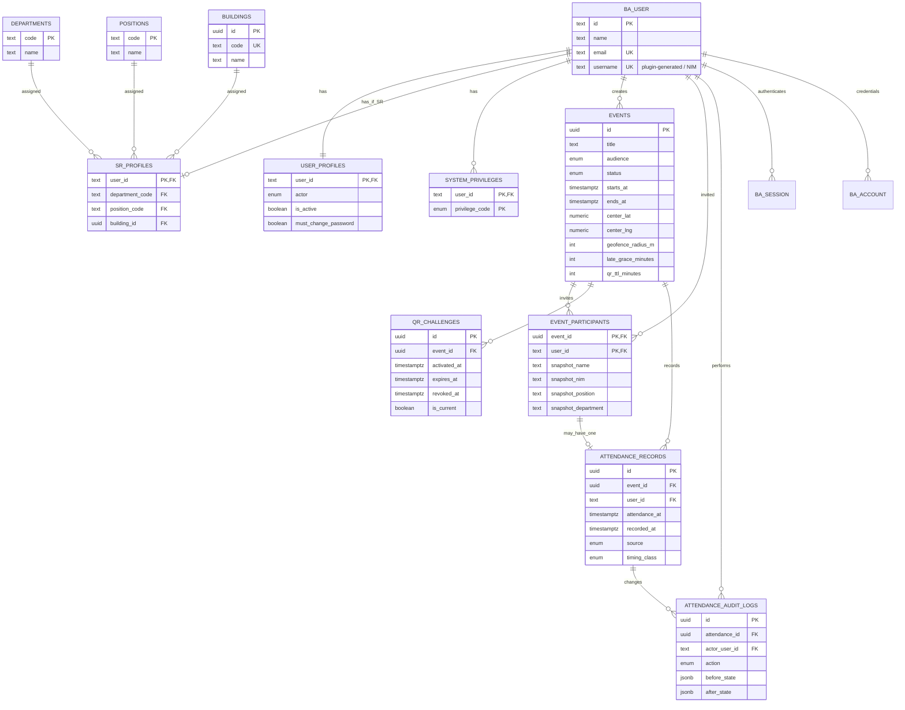

# RESORA — Data Model & Schema Specification (NEED-001)

**Version:** 0.3 · **Updated:** 2026-10-10 · **Status:** Phase 2A.6 identity migrations applied and verified on Supabase Development; future domain schema remains proposed\
**Target:** pilot presensi internal SR, 2026-10-18  
**Canonical repository path:** `docs/modules/need-001/resora-need-001-data-model.md`\
**Companion:** [NEED-001 PRD](prd.md), [architecture](../../architecture.md), [acceptance tests](acceptance-tests.md), [roadmap](roadmap.md)

> **Scope:** logical PostgreSQL/Drizzle design, **not executable migration SQL**. Do not run migrations from this document. Better Auth's **actual generated schema** takes precedence for its own four tables. Preserve pnpm 10.33.4 package management, Bun 1.3.13 Express runtime, Next.js/tRPC/Drizzle/Better Auth and Varlock; Supabase is managed PostgreSQL accessed **through Express only**. Do not use Supabase Auth or direct browser/database connections.

## 1. Decisions and semantics

| Area              | Policy / design                                                                                                                                                                                      | State                                                |
| ----------------- | ---------------------------------------------------------------------------------------------------------------------------------------------------------------------------------------------------- | ---------------------------------------------------- |
| Identity          | Exactly one primary actor per account (`SR`, `MAHASISWA`, `ASUS`, `DITMAWA`); only SR can sign in at pilot                                                                                           | Confirmed                                            |
| SR                | One department, one position, one building, active state; NIM login through Better Auth Username Plugin                                                                                              | Confirmed                                            |
| System permission | `SUPERADMIN` granted to a specifically authorized account; **not** a fifth actor. Initially only superadmin changes SR assignments and active status | Confirmed |
| Event audience    | One of `SR`, `KADIV`, `ALL_STUDENTS`; `KADIV` means position KADIV in **any** department; `ALL_STUDENTS` includes SR and MAHASISWA                                                                              | Confirmed                                            |
| Event organizer   | SR belonging to HCO can create event, show QR, view/export attendance; only **KADIV HCO** can input/correct manual attendance                                                                        | Confirmed                                            |
| Participant list  | Persist per-event eligible participant roster **at publication** to preserve historical reports and absent invitees                                                                                  | **Confirmed business rule; table design proposed**    |
| Attendance scan   | Valid while event is published and challenge is active/unexpired/unrevoked, including before `starts_at` and after `ends_at`                                                                         | Confirmed                                            |
| Timing            | `EARLY` if before event start; `ON_TIME` from start through 15-minute grace (configurable); `LATE` after grace                                                                                       | Confirmed                                            |
| QR                | Static within a configurable lifetime; default 6 hours since activation; no periodic rotation; HCO can revoke manually                                                                               | Confirmed                                            |
| Geofence          | HCO selects map pin or latitude/longitude center; separate configurable radius, **20 m confirmed default**; browser requests location; backend validates distance from untrusted/imperfect GPS | Confirmed; accuracy threshold/radius bounds TBD |
| Manual entry      | KADIV HCO selects an invited person by name/NIM; `attendance_at` defaults to server time but can be overridden; `recorded_at` is actual immutable server write time, plus mandatory reason and actor | Confirmed                                            |
| Non-attendees     | Record absence via a report **LEFT JOIN** over invited participants; do not insert fake attendance rows                                                                                              | Recommended                                          |
| Export            | Include every invited participant, attendance timestamp/status, time classification and lateness; exclude secrets and raw GPS coordinates                                                            | Confirmed                                            |
| Email             | Real SR email; planned backend Gmail SMTP display name `RnD SR XIV`; sender address/credentials in env. Recovery/verification in Phase 2 | Confirmed; operational setup TBD |

### Non-negotiable implementation principles

- PostgreSQL `timestamptz` for instants; display `Asia/Jakarta` in UI. Store NIM as **text**, never an integer.
- All authorization, QR token verification, event eligibility, duplicate checks, and geofence distance checks happen on the **backend**. The specific HMAC protocol below is proposed.
- Runtime uses `DATABASE_URL` (Supabase Session Pooler); migration tooling prefers `DIRECT_DB_URL`, reports IPv6/network failures explicitly and never silently retries another connection. [Setup](../../setup.md) documents deliberate pooler alternatives. Local Docker PostgreSQL is optional; VPS deployment planned.
- `attendance_at` is the **effective time of attendance**; `recorded_at` is **when the record was actually written**, including manual late entry.
- Data changes by KADIV must create append-only audit records. Do not use destructive delete as a routine correction.
- Do not store plaintext passwords, QR bearer tokens, Gmail app passwords or raw GPS coordinates in event reports.
- Include unique constraints and transactions at the **database** level, not only client-side checks.

## 2. ERD — domain overview



**Mermaid note:** `BA_*` represent existing Better Auth-managed tables, not new copies. The composite relationship between `event_participants` and `attendance_records` is enforced explicitly in migration with `(event_id, user_id)`; the ERD is a conceptual view.

## 3. Existing Better Auth tables — reuse, do not duplicate

| Table          | Responsibility                                                                              | Treatment                                                                                                              |
| -------------- | ------------------------------------------------------------------------------------------- | ---------------------------------------------------------------------------------------------------------------------- |
| `user`         | Core id, name, real email, email verification; Username Plugin adds login identifier fields | Let Better Auth CLI generate fields required by actual installed plugin version; verify uniqueness of NIM (`username`) |
| `session`      | Authenticated sessions                                                                      | Better Auth-managed                                                                                                    |
| `account`      | Credentials; its `password` column is auth-managed hashed credential                        | Never write raw passwords directly; use supported Better Auth APIs                                                     |
| `verification` | Auth/email verification/reset tokens                                                        | Better Auth-managed                                                                                                    |

**Phase 2A:** server Username Plugin and compatible generated `username` (nullable, unique) / `display_username` (nullable) fields are present in `packages/db/src/schema/auth.ts`. Plugin normalization is disabled to preserve NIM text; immutableUsername is enabled. Client integration and complete authentication enforcement remain later work. Phase 2A.6 applied and verified the foundation migrations on Development (§15); review any future unapplied migrations before application. Do not add a second application-level NIM column as a competing source of truth unless migration requirements dictate it.

## 4. Domain tables and columns — identity implemented; later domains proposed

Notation: **PK** primary key; **FK** foreign key; **UK** unique; **NN** not null. `timestamptz` = PostgreSQL timestamp with time zone. Defaults/constraints listed separately. Sections 4.1–4.4 are the authorized Phase 2A baseline defined in Drizzle, validated locally in Phase 2A.5 and applied/verified on Supabase Development in Phase 2A.6 (§15). Sections 4.5–4.9 remain future designs.

### 4.1 `user_profiles` — exclusive actor and account operational status

| Column                 | PG type           | Constraint/default             | Note                                                                  |
| ---------------------- | ----------------- | ------------------------------ | --------------------------------------------------------------------- |
| `user_id`              | `text`            | PK, FK → `user.id` CASCADE     | Exactly one profile per provisioned user                              |
| `actor`                | `actor_type` enum | NN                             | `SR`, `MAHASISWA`, `ASUS`, `DITMAWA`                                  |
| `is_active`            | `boolean`         | NN, default `true`             | Backend must reject inactive users even with existing session         |
| `must_change_password` | `boolean`         | NN, default `true` for imports | First-login gate; do not expose protected app actions until completed |
| `created_at`           | `timestamptz`     | NN, default now                |                                                                       |
| `updated_at`           | `timestamptz`     | NN, default now                | Update on mutation                                                    |

Database invariant: actor=`SR` has exactly one `sr_profiles` row and a nonblank auth-owned username; other actors have no SR profile. Phase 2A adds deferred constraint triggers checking final transactional state on actor/assignment mutations and auth username updates. Transactional provisioning remains future work; an ordinary FK alone cannot enforce the inverse relationship. Auth-only scaffold rows may remain unprovisioned without a profile; every provisioned identity must receive exactly one profile. Authentication authorization is not supplied by these storage constraints.

### 4.2 `departments`, `positions`, `buildings` — SR dictionary data

| Table         | Column                            | PG type                           | Constraint / note                                                                                                             |
| ------------- | --------------------------------- | --------------------------------- | ----------------------------------------------------------------------------------------------------------------------------- |
| `departments` | `code`, `name`, `is_active`       | `text`, `text`, `boolean`         | `code` PK; name NN; active NN default true. Seed HCO, Adaptif, Sosial, Akademik, Spiritual, Media, RnD                        |
| `positions`   | `code`, `name`, `is_active`       | `text`, `text`, `boolean`         | `code` PK; name NN; active NN default true. `KADIV` required, other position codes taken from roster—do not invent final list |
| `buildings`   | `id`, `code`, `name`, `is_active` | `uuid`, `text`, `text`, `boolean` | id UUID PK default generated; code UK/NN, name NN; code/name nonblank; active NN default true. Exact building names/codes from PM's CSV                                              |

For all dictionaries, avoid hard-delete while referenced. Dictionary editing restricted to `SUPERADMIN` in pilot.

### 4.3 `sr_profiles` — SR organizational assignment

| Column            | PG type       | Constraint/default               | Note                                   |
| ----------------- | ------------- | -------------------------------- | -------------------------------------- |
| `user_id`         | `text`        | PK, FK → `user_profiles.user_id` | Every SR has one current assignment    |
| `department_code` | `text`        | NN, FK → `departments.code`      | Exactly one department                 |
| `position_code`   | `text`        | NN, FK → `positions.code`        | `KADIV` is a position, not actor       |
| `building_id`     | `uuid`        | NN, FK → `buildings.id`          | Exactly one building                   |
| `created_at`      | `timestamptz` | NN, default now                  |                                        |
| `updated_at`      | `timestamptz` | NN, default now                  | Only superadmin may change assignments |

NIM comes from `user.username` (Better Auth Username Plugin). Do **not** duplicate NIM in `sr_profiles` unless an independently justified immutable institutional-id requirement emerges.

### 4.4 `system_privileges` — explicit superadmin permission

| Column               | PG type                 | Constraint/default       | Note                                                  |
| -------------------- | ----------------------- | ------------------------ | ----------------------------------------------------- |
| `user_id`            | `text`                  | FK → `user.id`, NN       |                                                       |
| `privilege_code`     | `system_privilege` enum | NN                       | Initially only `SUPERADMIN`                           |
| `granted_at`         | `timestamptz`           | NN, default now          |                                                       |
| `granted_by_user_id` | `text`                  | FK → `user.id`, nullable | Nullable only for securely recorded initial bootstrap |

**Composite PK:** `(user_id, privilege_code)`. Bootstrap superadmin through audited, non-public mechanism. `SUPERADMIN` allows SR master maintenance **only as explicitly authorized**; do not implicitly bypass every HCO rule.

### 4.5 `events` — HCO-created internal event

| Column               | PG type               | Constraint/default  | Note                                                   |
| -------------------- | --------------------- | ------------------- | ------------------------------------------------------ |
| `id`                 | `uuid`                | PK, generated       |                                                        |
| `title`              | `text`                | NN                  | Non-empty after trim                                   |
| `description`        | `text`                | nullable            |                                                        |
| `created_by_user_id` | `text`                | NN, FK → `user.id`  | Backend verifies SR in HCO                             |
| `audience`           | `event_audience` enum | NN                  | `SR`, `KADIV`, `ALL_STUDENTS`                          |
| `status`             | `event_status` enum   | NN, default `DRAFT` | `DRAFT`, `PUBLISHED`, `CLOSED`, `CANCELLED`            |
| `starts_at`          | `timestamptz`         | NN                  | Scheduled start, **not** QR opening limit              |
| `ends_at`            | `timestamptz`         | NN                  | Scheduled end, **not** QR expiry limit                 |
| `center_lat`         | `numeric(9,6)`        | NN                  | −90 to 90                                              |
| `center_lng`         | `numeric(9,6)`        | NN                  | −180 to 180                                            |
| `geofence_radius_m`  | `integer`             | NN, default 20      | Allowed min/max **TBD**                                |
| `late_grace_minutes` | `integer`             | NN, default 15      | Must be ≥ 0; max TBD                                   |
| `qr_ttl_minutes`     | `integer`             | NN, default 360     | 6h default; bounds TBD                                 |
| `published_at`       | `timestamptz`         | nullable            | Set on publish and snapshot creation                   |
| `closed_at`          | `timestamptz`         | nullable            | Set on explicit authorized HCO close; QR invalidated atomically |
| `created_at`         | `timestamptz`         | NN, default now     |                                                        |
| `updated_at`         | `timestamptz`         | NN, default now     |                                                        |

**Proposed storage constraints:** `ends_at > starts_at`; `geofence_radius_m > 0`; `qr_ttl_minutes > 0`; `late_grace_minutes >= 0`; coordinate range checks. After publication only title/description edits are confirmed; audience and schedule are immutable and participant snapshots retained. **Recommended, pending PM confirmation:** freeze center/radius/late tolerance. Authorized HCO explicitly closes the event, atomically invalidating its active QR and projecting missing attendance as ABSENT. Manual correction after closure and cancellation/reopening remain pending policy review. Do not automatically set `CLOSED` simply because scheduled `ends_at` passed.

### 4.6 `event_participants` — roster snapshot at publication

| Column                | PG type           | Constraint/default   | Note                                                   |
| --------------------- | ----------------- | -------------------- | ------------------------------------------------------ |
| `event_id`            | `uuid`            | NN, FK → `events.id` |                                                        |
| `user_id`             | `text`            | NN, FK → `user.id`   |                                                        |
| `invited_at`          | `timestamptz`     | NN, default now      |                                                        |
| `snapshot_actor`      | `actor_type` enum | NN                   | Historical actor                                       |
| `snapshot_nim`        | `text`            | nullable             | Historical NIM; nullable for future actors lacking NIM |
| `snapshot_name`       | `text`            | NN                   | Historical display name                                |
| `snapshot_department` | `text`            | nullable             | Name/code at publication                               |
| `snapshot_position`   | `text`            | nullable             | For KADIV events/report                                |
| `snapshot_building`   | `text`            | nullable             | Human-readable value at publication                    |

**Composite PK:** `(event_id, user_id)`. Index `(user_id, event_id)`. Publish event + insert eligible current **active** users into `event_participants` **in a transaction**. This supports stable “invited but absent” reporting even if positions change afterward. Confirmed inactive/deactivated users cannot sign in/check in even when previously snapshotted.

**Audience filter at publication:** `SR` = active actor SR; `KADIV` = active actor SR + `position_code=KADIV` across departments; `ALL_STUDENTS` = active actor in {SR, MAHASISWA}. Pilot may list only currently provisioned SR; do not imply MAHASISWA login works yet.

### 4.7 `qr_challenges` — fixed event QR, server-verifiable token

| Column              | PG type       | Constraint/default   | Note                                                       |
| ------------------- | ------------- | -------------------- | ---------------------------------------------------------- |
| `id`                | `uuid`        | PK, generated        | Unpredictable challenge identifier                         |
| `event_id`          | `uuid`        | NN, FK → `events.id` |                                                            |
| `activated_at`      | `timestamptz` | NN, server time      | QR begins here; **not** at event start                     |
| `expires_at`        | `timestamptz` | NN                   | Activation + configured TTL                                |
| `revoked_at`        | `timestamptz` | nullable             | Manual immediate invalidation                              |
| `is_current`        | `boolean`     | NN, default `true`   | Reissue only through explicit HCO action; no auto-rotation |
| `issued_by_user_id` | `text`        | NN, FK → `user.id`   | HCO issuer                                                 |
| `created_at`        | `timestamptz` | NN, default now      |                                                            |

**Partial unique index:** one `is_current = true` challenge per event. In explicit replacement/reissue transaction, mark previous challenge non-current, then issue a new one. Default TTL 360 minutes; no automatic rotation.

**Crucial redisplay design:** HCO needs to display the **same QR across refreshes**. Do **not** store an unencrypted bearer token and do **not** rely solely on saving a one-way token hash (which cannot regenerate the same QR). Recommended stateless reconstruction: QR encodes a URL with a version, `challenge_id`, and an HMAC signature generated from the ID using a dedicated backend-held `QR_SIGNING_SECRET`. The server regenerates the _same_ signed QR for authorized HCO display; verification checks signature + database challenge status, expiry, revocation, `is_current`, authenticated user, event audience, geofence and uniqueness. Use constant-time MAC verification. Never expose signing key. Prevent leaking QR payload through logs/referrers; consider URL fragments for client handoff. This supports reusable QR infrastructure for NEED-007 without embedding attendance policy in the QR primitive.

**Constraint:** `expires_at > activated_at`. HCO may explicitly reissue expired or revoked QR: previous challenges remain invalid; new activation + configured TTL (default six hours). No automatic rotation. Reissue must not silently invent a reopening policy for closed events.

### 4.8 `attendance_records` — one confirmed attendance per event/user

| Column                | PG type                  | Constraint/default            | Note                                                                        |
| --------------------- | ------------------------ | ----------------------------- | --------------------------------------------------------------------------- |
| `id`                  | `uuid`                   | PK, generated                 |                                                                             |
| `event_id`            | `uuid`                   | NN, FK → `events.id`          |                                                                             |
| `user_id`             | `text`                   | NN, FK → `user.id`            | Must be invited via composite FK                                            |
| `attendance_at`       | `timestamptz`            | NN                            | Effective attendance instant; scan: server time; manual: override permitted |
| `recorded_at`         | `timestamptz`            | NN, default now               | Immutable actual server insert time                                         |
| `source`              | `attendance_source` enum | NN                            | `QR`, `MANUAL`; original source retained on corrections |
| `timing_class`        | `attendance_timing` enum | NN                            | `EARLY`, `ON_TIME`, `LATE` from event policy; tolerance freeze awaiting PM confirmation |
| `recorded_by_user_id` | `text`                   | NN, FK → `user.id`            | QR: same as user_id; manual: KADIV HCO                                      |
| `manual_reason`       | `text`                   | nullable; required for manual | Audit/business explanation                                                  |
| `updated_at`          | `timestamptz`            | NN, default now               | Update only via audited correction                                          |

**UK `(event_id, user_id)`**, and **composite FK** `(event_id, user_id)` → `event_participants(event_id, user_id)`; index `(user_id, attendance_at DESC)`. Application + SQL check for `source=MANUAL` requiring nonblank reason, and server verified KADIV HCO.

**QR:** `attendance_at = recorded_at = server time`, `recorded_by_user_id=user_id`. **Manual:** `recorded_at = immutable server insertion time`, `attendance_at = KADIV supplied effective time or server time`, `recorded_by_user_id=KADIV`; no trust in a timestamp from a QR scan request.

Do not store a separate `PRESENT` boolean: existence of an attendance record means present. Missing attendance states are computed on the invitation/report query (see §5). Avoid hard deleting attendance; correction service updates record and inserts immutable audit in one transaction. Prevent concurrent check-ins/manual inserts using the database unique constraint, not a read-then-write race.

### 4.9 `attendance_audit_logs` — immutable manual/correction history

| Column          | PG type                        | Constraint/default               | Note                                                           |
| --------------- | ------------------------------ | -------------------------------- | -------------------------------------------------------------- |
| `id`            | `uuid`                         | PK, generated                    |                                                                |
| `attendance_id` | `uuid`                         | NN, FK → `attendance_records.id` |                                                                |
| `event_id`      | `uuid`                         | NN, FK → `events.id`             | Denormalized for event audit lookup                            |
| `user_id`       | `text`                         | NN, FK → `user.id`               | Subject of attendance                                          |
| `actor_user_id` | `text`                         | NN, FK → `user.id`               | KADIV HCO acting                                               |
| `action`        | `attendance_audit_action` enum | NN                               | `MANUAL_CREATED`, `ATTENDANCE_CORRECTED`                       |
| `before_state`  | `jsonb`                        | nullable                         | Null on first manual creation; no credentials/location secrets |
| `after_state`   | `jsonb`                        | NN                               | Safe changed attendance fields only                            |
| `reason`        | `text`                         | NN                               | Mandatory, non-empty                                           |
| `created_at`    | `timestamptz`                  | NN, default now                  | Append-only timestamp                                          |

Index `(attendance_id, created_at)` and `(event_id, created_at)`; actor can INSERT only through approved backend services. Routine UPDATE/DELETE denied (ideally database role/trigger policy too). Audit insertion must happen **in the same transaction** as manual record creation or correction.

## 5. State and classification rules

### 5.1 Timing formula

Using immutable **event start** and configurable grace period:

```text
seconds_from_start = attendance_at - events.starts_at   (signed seconds)

if attendance_at < starts_at:
    timing_class = EARLY
else if attendance_at <= starts_at + late_grace_minutes:
    timing_class = ON_TIME
else:
    timing_class = LATE

minutes_after_start = max(0, floor(seconds_from_start / 60))
minutes_past_grace = max(0, ceil((seconds_from_start - grace_seconds) / 60))
```

**Display policy recommended:** show both **“Menit setelah mulai”** (e.g. 25 min) and **“Terlambat melewati toleransi”** (e.g. 10 min for a 15-min grace). This removes ambiguity from the word _keterlambatan_. For early scans, display signed early offset separately. Exact rounding/unit display to confirm with PM; server calculation must be consistent.

### 5.2 Presence state (report projection, not a table)

| Situation                          | Derived presence state     | Timing class               |
| ---------------------------------- | -------------------------- | -------------------------- |
| Has `attendance_records` row       | `PRESENT` / Hadir          | `EARLY`, `ON_TIME`, `LATE` |
| No row, event not closed/cancelled | `PENDING` / Belum presensi | —                          |
| No row, event `CLOSED`             | `ABSENT` / Tidak hadir     | —                          |
| Event `CANCELLED`                  | `CANCELLED` / Dibatalkan   | —                          |

Compute with `event_participants LEFT JOIN attendance_records`; participants without records remain visible. **CONFIRMED:** authorized HCO closes explicitly, invalidating active QR; missing attendance becomes ABSENT. QR expiration/revocation or scheduled end alone does not close an event. Cancellation/reopening projection remains TBD.

### 5.3 Scan decision flow

1. Validate Better Auth session and active `user_profiles` with actor SR.
2. Parse/verify QR HMAC, ensure current, published event, activated, unexpired, unrevoked challenge.
3. Confirm `(event_id,user_id)` exists in `event_participants`; evaluate account active and current policy constraints.
4. Request browser coordinates + accuracy and validate geofence on backend; handle bad accuracy as an explicit manual-fallback case.
5. Use **server clock**, compute timing class, perform atomic insert with unique `(event_id,user_id)` enforcement.
6. Duplicate requests return stable “already recorded” response without changing existing timestamp.

**Never** rely on GPS location alone as proof. On GPS denial, poor accuracy, or out of radius, show _hubungi KADIV HCO untuk input manual_, not a public bypass or unapproved SR request workflow.

### 5.4 Manual upsert / correction

1. KADIV HCO selects an **invited participant** from this event's snapshot by NIM/name.
2. If no attendance exists, create a `MANUAL` record with `attendance_at = current server time` unless KADIV supplies actual effective time; `recorded_at` remains current server time.
3. If attendance exists, present a **correction** action (not a second insert); require reason, save before and after.
4. Validate effective timestamps and audit overrides. Allowed historical/future bounds are **TBD**; rejecting future timestamps is a **PROPOSED** safeguard, not a confirmed rule.
5. Perform attendance mutation + append-only audit atomically; preserve original `recorded_at` **and original source** on corrections, and record later correction timestamp in audit.
6. Recalculate timing classification from corrected `attendance_at` and frozen event policy.

## 6. Constraints and required indexes (migration checklist)

- [ ] Unique Better Auth username/NIM and email after plugin generation; no duplicate NIM source of truth.
- [ ] `user_profiles.user_id` PK and actor enum (single primary actor).
- [ ] `sr_profiles.user_id` PK; NOT NULL department, position, building FKs.
- [ ] `system_privileges` composite PK `(user_id, privilege_code)`.
- [ ] `events`: start < end, coordinates within bounds, positive radius/TTL, nonnegative grace.
- [ ] `event_participants` PK `(event_id, user_id)`; `(user_id,event_id)` index for own events.
- [ ] `qr_challenges`: partial unique `(event_id) WHERE is_current = true`; expiration > activation.
- [ ] `attendance_records`: unique `(event_id, user_id)` and composite FK to `event_participants`; own-history index.
- [ ] `attendance_audit_logs`: append-only with event and record indexes; mandatory reason.
- [ ] All inserts and privileged updates enforce authorized user/department/position on server.
- [ ] Event publication + participant snapshot transaction; QR reissue transaction; manual insert/correction + audit transaction.
- [ ] Avoid cascade deleting historical events/participants/attendance; soft archive where necessary.
- [ ] Generated Drizzle SQL/migrations reviewed and committed before applying to **Supabase Development**.

## 7. CSV import contract (PM delivers later)

| CSV field         | Required | Destination / handling                                               |
| ----------------- | -------- | -------------------------------------------------------------------- |
| `nim`             | Yes      | Better Auth `user.username`; trim/validate, preserve leading zeros   |
| `name`            | Yes      | `user.name` and future `event_participants.snapshot_name`            |
| `email`           | Yes      | `user.email`; unique, real user-owned address; verification separate |
| `department_code` | Yes      | FK `sr_profiles.department_code`; existing dictionary                |
| `position_code`   | Yes      | FK `sr_profiles.position_code`; codes from PM's actual list          |
| `building_code`   | Yes      | Resolve `buildings.code` → `sr_profiles.building_id`                 |
| `is_active`       | Yes      | `user_profiles.is_active`; true/false parse strictly                 |

Use **synthetic data** until real CSV arrives. Production import must be idempotent, preview/report invalid rows before committing, validate duplicates both in-file and against DB, and provision account/password via Better Auth's supported server API. Passwords never appear in source-controlled CSV. Secure delivery channel for initial credentials is TBD. The seven business columns are confirmed; technical headers shown above and casing/normalization rules remain a proposed import mapping. CSV is needed before final UAT, not to unblock schema implementation.

## 8. Ownership and authorization (pilot)

| Object / operation                         | SR  | HCO SR | KADIV HCO | SUPERADMIN                                         |
| ------------------------------------------ | --- | ------ | --------- | -------------------------------------------------- |
| Own invited event, own attendance          | Yes | Yes    | Yes       | Only if eligible, unless separately approved       |
| Create/publish event and QR, revoke QR     | No  | Yes    | Yes       | Not automatically                                  |
| See/export attendance for HCO event        | No  | Yes    | Yes       | Not automatically                                  |
| Manual attendance create/correct           | No  | No     | Yes       | Not automatically                                  |
| Manage SR assignments / account activation | No  | No     | No        | Yes                                                |
| Grant system privileges                    | No  | No     | No        | Controlled bootstrap/explicit grant procedure only |

Disallow broad raw DB access from browser. Server executes privileged queries using restricted application credentials; **Supabase `service_role` or public client keys are not required** for Drizzle PostgreSQL connectivity.

## 9. Implementation sequence (for Codex after schema approval)

1. **F2 auth:** Better Auth Username Plugin, generated auth schema, `user_profiles`, SR dictionary, `sr_profiles`, `system_privileges`, import from synthetic roster; password flows + Gmail SMTP later in F2.
2. **F3 RBAC:** server-side active actor, HCO department, KADIV position, superadmin checks.
3. **F4 event:** `events`, `event_participants` snapshot on publish, `qr_challenges`, event challenge issue/display/revoke.
4. **F5 scan:** `attendance_records`, HMAC verification, geofence and timing classification, idempotent insertion.
5. **F6 manual/export:** `attendance_audit_logs`, effective vs recorded time, event participant LEFT JOIN report and CSV export.
6. **F7–F8:** integration tests, real GPS mobile test, email/send safety checks, migration repeatability, deploy/UAT.

Do not implement every table at once if incremental migrations can be safely deployed. Preserve Better Auth-generated schema authority and Drizzle RC-compatible APIs from the actual repo.

## 10. Decisions to close before implementation / production

| ID   | Open item                                                                                               | Impact                                                |
| ---- | ------------------------------------------------------------------------------------------------------- | ----------------------------------------------------- |
| D-01 | Cancellation/reopening/republication handling; title/description-only published edits are confirmed                     | `event_participants` lifecycle and historical reports |
| D-02 | Final PM confirmation of recommended center/radius/late-tolerance freeze at publication                 | Stable geofence/timing policy                         |
| D-03 | QR TTL/grace bounds; radius range and GPS accuracy threshold after field testing                       | Validation policy and UAT                             |
| D-04 | Closed-event reopening policy (explicit expired/revoked QR reissue is already confirmed)                                                            | HCO event operations                                  |
| D-05 | Manual time override allowed range and whether corrected effective time can precede event start by days | Audit and fraud controls                              |
| D-06 | Gmail SMTP sender configuration, recovery/verification policy and secure temporary password delivery      | Account readiness                                     |
| D-07 | Exact SR CSV values (buildings/positions); optional default center presets (HCO selects map/lat-lng)     | Pilot real-data import                                |
| D-08 | Attendance data retention, export access logging, and timezone/rounding display                         | Compliance and historical reporting                   |

Until approved, don't silently convert these proposal-level details into product requirements. Implementation may use safe technical defaults with explicit review gates only where user-approved behavior is not affected.

## 11. Acceptance data examples (synthetic)

Event starts **13:00 Asia/Jakarta**, grace **15 min**, QR activated 12:00 and expires 18:00. All examples satisfy auth, eligibility, geofence and token checks.

| Effective attendance  | Presence | Timing  | Minutes after start | Minutes past grace | Source |
| --------------------- | -------- | ------- | ------------------: | -----------------: | ------ |
| 12:45                 | PRESENT  | EARLY   |                   0 |                  0 | QR     |
| 13:00                 | PRESENT  | ON_TIME |                   0 |                  0 | QR     |
| 13:10                 | PRESENT  | ON_TIME |                  10 |                  0 | QR     |
| 13:15                 | PRESENT  | ON_TIME |                  15 |                  0 | QR     |
| 13:16                 | PRESENT  | LATE    |                  16 |                  1 | QR     |
| 13:25                 | PRESENT  | LATE    |                  25 |                 10 | QR     |
| No scan, event open   | PENDING  | —       |                   — |                  — | —      |
| No scan, event closed | ABSENT   | —       |                   — |                  — | —      |

Manual example: KADIV saves at 17:00 but sets effective presence at 13:05. Persist `attendance_at=13:05`, `recorded_at=17:00`, `source=MANUAL`, `timing_class=ON_TIME`, actor KADIV HCO, non-empty reason, and immutable audit row. Never retroactively rewrite the initial `recorded_at`.

## 12. Repository compatibility review (2026-10-10)

**Phase 2A review (updated after the documentation baseline):** reviewed `packages/db/src/schema/auth.ts`, schema exports, `packages/auth/src/index.ts`, package scripts, `pnpm-workspace.yaml` and the Phase 1 baseline migration. The repository now defines four Better Auth tables with generated username fields and the six identity tables in §4.1–§4.4. Phase 2A.5 applied/introspected all three migrations locally; Phase 2A.6 applied and verified the same chain on Supabase Development (§15). Event/QR/attendance tables remain proposed. Phase 2A changes schema definitions, auth plugin configuration and migration/test files; environment/connection/package-manager configuration is preserved.

| Coverage / discrepancy | Actual repository or current proposal | Suggested correction / review gate |
| --- | --- | --- |
| Better Auth core keys and relations | Text PKs on `user`, `session`, `account`, `verification`; unique email/session token; session/account `user_id` NN FK to `user` with cascade; user/identifier indexes | Reuse generated names/types/relations; do not duplicate Better Auth tables |
| Better Auth nullability/defaults | User name/email NN; email_verified NN default false; image nullable. Session expiry/token/user NN, IP/user-agent nullable. Account IDs/provider/user NN, password/tokens/scope/expiry nullable. Verification identifier/value/expiry NN. Creation defaults exist; session/account updated_at are NN with application on-update but **no database default** | Preserve auth-owned credential/token semantics; exercise provisioning through supported APIs rather than raw inserts that assume defaults |
| Username/NIM | Server Username Plugin enabled; generated nullable username/displayUsername fields and unique username present | Phase 2A generated/reviewed compatible fields; deferred integrity SQL requires nonblank username for SR. Preserve NIM as text. Do not hand-copy the conceptual ERD as executable auth schema |
| Authentication policy | Config now includes Username Plugin; signup denial, active-account authorization, first-password-change enforcement and email callbacks are not implemented in Phase 2A | Phase 2 implements NIM login, server-side signup denial, secure provisioning/password change, active-account enforcement and planned Gmail flows; do not treat core tables as completed authentication |
| Actor/SR identity and active state | Actor/active/password-change flags and SR profile defined; auth enforcement remains pending | PK/enum/FKs and deferred SR consistency implemented in versioned SQL validated locally in Phase 2A.5; future provisioning must write complete identity transactionally. Reject inactive authentication/existing-session actions/check-in even if snapshotted |
| Superadmin and dictionaries | Privilege composite PK and dictionary references defined; no bootstrap/grant/maintenance service implemented | Review controlled bootstrap and explicit grant access. Only superadmin changes SR assignments/active status initially. Other position/building values await actual CSV; no blanket attendance bypass |
| Dictionary required fields | Building code/name now NN/nonblank; SR inverse actor condition supplied by deferred integrity migration | Authorized Phase 2A adopts the documented clarification; explicit synthetic tests cover constraints, with local database execution passing in Phase 2A.5; Supabase application still requires approval |
| Invitations and inactive users | Publication snapshot is now **CONFIRMED**, while table/field implementation remains proposed; composite `(event_id,user_id)` PK and user-event index documented | Atomic publish + eligible roster snapshot; preserve all invitees in reports. Snapshot cannot override live inactive status. Snapshot NIM/organization fields nullable for future actors; require populated SR snapshots in pilot validation |
| Event policy | Proposed NN schedule/center, defaults 20m/15min/360min, positive/range checks; publish/close timestamps nullable | Validate coordinate center separately from meter radius, schedule order and default policies. **PROPOSED:** conditional published_at/closed_at consistency checks. Audience/schedule immutability and explicit HCO close are confirmed; center/radius/grace freeze still proposed; scheduled end cannot close active QR scanning |
| QR validity | Proposed activation/expiration NN, revoked_at nullable, event/issuer FKs, partial unique current challenge | Preserve static default six-hour activation lifetime/revocation. HMAC reconstruction and random UUID challenge IDs are proposed protocol details; require unpredictable event-bound token, not guessable ID alone. Explicit expired/revoked reissue using configured TTL is confirmed; closed-event reopening remains TBD |
| Attendance identity and time | Proposed unique event/user + composite invitation FK, effective attendance_at NN, immutable recorded_at default now; source/timing NN; manual reason conditional | Implement only after review; reason must be nonblank for manual insert/correction. Compute timing with inclusive tolerance; preserve recorded_at on correction. Presence derived from invitation LEFT JOIN, separate from timing |
| Audit and provenance | Proposed append-only audit with mandatory reason, before nullable only on insertion, after NN, actor/attendance/event/user FKs and event/record indexes | **PROPOSED strengthening:** enforce audit event/user matches its attendance row (composite FK or validated transaction), restrict updates/deletes, preserve immutable creation time. Corrections must preserve original QR/MANUAL source; audit retains original/new states |
| Historical deletes | Auth child sessions/accounts cascade on user deletion; proposed domain FK deletion behavior is mostly unspecified | **PROPOSED:** restrict deletion of users/events referenced by invitation/attendance/audit; prefer deactivation/archive. Do not propagate auth cascade into attendance history without review |
| Timestamp mapping | Actual Better Auth uses `timestamp()` **without time zone**; proposed domain instants use `timestamptz` | Preserve auth-generated schema unless a reviewed compatible migration is separately approved. Explicitly handle UTC conversion and Asia/Jakarta display; test interoperability rather than silently changing auth columns |
| Reporting | Proposed LEFT JOIN covers invited non-attendees; classification examples correct at start/grace boundary | Required CSV contains NIM/name, appropriate organization snapshots, presence, effective timestamp, timing, lateness duration and source; no passwords, sessions, QR secrets or raw GPS. Duration basis/rounding and cancellation projection await review; explicit HCO closure is confirmed |

**Additional TBDs:** backdated manual entries for currently inactive invitees; manual correction after closure; canceled-event reporting. Original attendance source preservation on correction is confirmed. These supplement §10 without changing confirmed rules. `CLOSED` storage, HMAC and the report projection mechanism remain proposals; pending-to-absent at attendance-window closure is confirmed. Do not implement proposal details as approved policy by implication.

**Readiness:** confirmed requirements and acceptance cases support a reviewed Drizzle schema plan and Phase 2 authentication design. Resolve affected TBDs before implementing those behaviors; review the proposed schema/constraints and generated auth changes before any migration. Phase 2A.5 local validation passed; stop for explicit approval and target review before applying to Supabase. Phase 1 connectivity and pnpm verification remain recorded in [setup](../../setup.md) and [migration report](../../pnpm-migration.md).

## 13. Phase 2A identity foundation implementation record

**Scope:** server Username Plugin, generated compatible auth fields, six Drizzle identity tables, relations, PK/FK/index/check constraints, versioned additive SQL and synthetic tests. No UI, event/QR/attendance tables, SMTP, CSV provisioning, authentication authorization flows or application RBAC services. Those remain future work. Active/password-change flags and superadmin grants are storage foundations, not enforcement of those actions by themselves.

### Migration chain (unapplied at Phase 2A; validated locally in 2A.5 and applied to Development in 2A.6)

1. Existing `20261010093513_phase1_scaffold`: untouched SQL/snapshot creates only `user`, `session`, `account`, `verification`.
2. `20261010114142_phase2a_identity`: adds username/display_username and unique username; creates actor/privilege enums, six identity tables, required/unique dictionary fields, assignment/grant FKs and indexes. No duplicate auth creation, drops, data deletes or auth timestamp conversion. Composite/table PKs imply NOT NULL in PostgreSQL even where generated SQL omits an explicit clause.
3. `20261010114235_phase2a_identity_integrity`: custom SQL adds one function and three deferred constraint triggers. SR requires exactly one assignment and nonblank auth-owned NIM; non-SR requires none. Both old/new identities are checked on reassignment. Parent locks serialize checks; rejected inconsistent transactions must roll back. Function is invoker-security with fixed search_path and qualified tables. See [PostgreSQL constraint triggers](https://www.postgresql.org/docs/current/sql-createtrigger.html).

All directories contain SQL and snapshot metadata. The custom trigger/function definitions are deliberately tracked in custom SQL, not represented by Drizzle snapshots; preserve them in later migrations. Existing Better Auth timestamp/default/cascade semantics are retained. Domain instants use timestamptz. No dictionary data, real identities or superadmin are seeded. SR/dictionary/grant references use non-cascading FK defaults, except canonical user_profiles → auth user CASCADE; removal of referenced identities/dictionaries is constrained. Database permissions for future superadmin operations are not created here.

### Generation and review commands

- `pnpm run auth:generate`: Better Auth CLI 1.7.7 generated username fields; reviewed against installed Better Auth 1.7.7. Existing script now pins `auth@1.7.7` to avoid future CLI drift. Initial pre-generation schema-mismatch diagnostic was expected. Preserve generated semantics; normalize formatting minimally.
- `pnpm run db:generate --name=phase2a_identity`: generated additive migration from the unchanged Phase 1 snapshot; no database connection/query.
- `pnpm run db:generate --custom --name=phase2a_identity_integrity`: generated custom migration directory, then reviewed cross-table integrity SQL added.
- `pnpm run db:generate --name=phase2a_verify`: reports **no schema changes**; adds no files. Confirms generated snapshots and source remain aligned.
- Host Varlock commands used the existing optional session telemetry workaround from setup. No env files, DATABASE_URL/DIRECT_DB_URL handling or lockfile/dependency versions changed.

### Tests and migration readiness

| Command/check | Phase 2A result |
| --- | --- |
| `pnpm run test:identity` | 10 offline tests pass, 90 assertions. 23 local PostgreSQL cases intentionally not executed (Bun reports 25 skips including hooks); no scratch URL was supplied |
| `pnpm run test:smoke` | Existing four connectivity unit tests pass; no database connection acquired |
| `pnpm run check-types` | All six workspace tasks pass |
| `pnpm run build` | Both Express and Next.js production builds pass using existing Varlock telemetry workaround |
| Targeted read-only Biome | Nine identity/source/snapshot files pass normal checks; auth schema/root/server manifests pass with formatter disabled to preserve existing formatting |
| `pnpm run lint --max-diagnostics=5 --reporter=summary` | Fails on remaining scaffold formatting/import/accessibility issues: 86 errors, 69 warnings, 1 info; no whole-repo fixes applied |
| `git diff --check`, Markdown links/table/fence checks | Pass: 11 changed Markdown files, 42 internal links/anchors, 37 tables, balanced fences and AT-001–049; protected integration/baseline/lockfile/frontend files unchanged |

Initial Bun/pnpm commands hit Windows sandbox EPERM/EACCES resolving pnpm links/CLI cache; approved retries passed. Generation's expected pre-refresh username-field diagnostic was resolved by the generated fields. An initial migration-chain test incorrectly treated `.gitkeep` as a migration directory; restricting it to the three foundation migrations fixed the test. Targeted auth import ordering was corrected. No dependency upgrades or live database operations were used to resolve these issues.

Run `pnpm run test:identity` for offline plugin/schema/SQL/chain checks using synthetic fixtures. Local PostgreSQL tests are opt-in via **RESORA_IDENTITY_TEST_DB_URL**, accept only loopback `resora_identity_test_*` databases without URL options, and never read DATABASE_URL/DIRECT_DB_URL or run DDL/migrations. They require the complete reviewed migration chain already applied manually to that disposable database; ordinary cases roll back synthetic data; commit-boundary probes explicitly clean their committed synthetic fixtures. Guards reject Supabase and ordinary application DB names. Do not point tests at Development or production.

After review and separate approval/manual application of the chain to that local scratch database, privately set the test URL, run tests and restore the previous variable value:

```powershell
# Placeholder only; use your private loopback scratch connection after review.
$env:RESORA_IDENTITY_TEST_DB_URL = '<loopback URL for resora_identity_test_review>'
pnpm.cmd run test:identity
# Remove this override if it was previously unset; otherwise restore its prior value.
Remove-Item Env:RESORA_IDENTITY_TEST_DB_URL
```

**Phase 2A readiness (historical; superseded by §14):** SQL ready for review, not approved/applied or validated on PostgreSQL at that phase. Before applying anything, review this chain and custom triggers; verify the target has no existing tables/migration history requiring reconciliation; obtain approval. After review, apply to an explicitly selected disposable local database and run the opt-in integrity suite before considering a separately approved Development migration. Use the existing Varlock/direct connection preflight and explicit Session Pooler alternative in [setup](../../setup.md); do not use db:push or silently switch connections. No migration ran in Phase 2A.

## 14. Phase 2A.5 local PostgreSQL validation

**Date:** 2026-10-10 (Asia/Jakarta). **Authorization:** this phase explicitly authorized disposable local migration application/testing. Supabase Development and production were not connected to or modified. No schema, migration SQL/snapshot, dependency, lockfile, environment file or application feature changed.

### Environment and safety audit

- Windows native PostgreSQL **18.3**, using the existing installation at `C:/Program Files/PostgreSQL/18/bin`. Bun **1.3.13**, pnpm **10.33.4**, installed Drizzle Kit/ORM **1.0.0-rc.4** retained.
- Docker Desktop was running, but `docker info` hung and returned HTTP 500 from the Linux Engine API. No Docker pull, container start, prune or disk repair was attempted. Host free space before setup: approximately **16.4 GiB C:** and **83.2 GiB E:**. Native PostgreSQL provided a working alternative.
- Dedicated cluster: ignored `tmp/phase2a5-postgres/data`; bound only to **127.0.0.1:55432**, UTC timezone, role `resora_identity_test`, database **resora_identity_test_phase2a5**. Local trust authentication was limited to this disposable loopback cluster, which is stopped after validation; do not use it for shared/deployed resources. Retained scratch files are ignored for review/reuse.
- Verified server address/port/version before database creation, then verified the exact database name and zero public tables before migration DDL. Process overrides set **both DATABASE_URL and DIRECT_DB_URL** to the scratch target. A temporary guard verified Varlock resolved both overrides exactly; no Supabase fallback occurred. All overrides were restored and URLs/credentials withheld from logs.
- Native `pg_ctl` startup and pnpm-linked imports needed approved execution outside the Windows sandbox. Temporary PowerShell execution policy applied only to the wrapper process; machine policy was not changed. A Windows inline-argument quoting failure was resolved with a temporary source file before migrations ran.

Audit: Phase 1 creates four auth tables before adding their FKs. Identity enums precede their columns; all six identity tables exist before assignment/grant FKs are added. Username columns/uniqueness ALTER the existing auth table. PKs enforce non-null identities (including the composite privilege key); all indexes and checks are additive. The final migration creates the function before three AFTER ROW, DEFERRABLE INITIALLY DEFERRED constraint triggers. Trigger checks use final transactional state, qualified public tables and parent locks. No duplicate table creation or destructive SQL was found.

### Execution and evidence

| Check / command | Result |
| --- | --- |
| Native `initdb`, `pg_ctl`, guarded local `createdb`, target `SELECT` | Isolated PostgreSQL cluster and empty scratch database prepared successfully |
| `pnpm --dir packages/db run db:migrate` | Existing Varlock/direct preflight passed SELECT 1; all three versioned migrations applied in order |
| Catalog/history validation | Ten public tables; two enums; ten PKs, nine validated FKs, four unique constraints, six checks; 22 valid indexes; generated nullable text username/display_username; three deferred triggers |
| Drizzle history | `drizzle.__drizzle_migrations` contains exactly three entries; ordered names, SHA-256 file hashes and timestamp keys match `readMigrationFiles`; applied_at populated |
| Second `pnpm --dir packages/db run db:migrate` | Success with identical object OIDs, constraints, indexes, triggers, function definition and history rows; no duplicated objects or history edits |
| Local `pnpm run test:identity` | **38 passed, 0 failed, 0 skipped; 154 assertions**: 28 PostgreSQL cases plus ten offline plugin/schema/guard tests |
| Default `pnpm run test:identity` after stopping scratch DB | **10 passed, 0 failed; 30 skips** (28 PostgreSQL cases and two hooks); verifies opt-in behavior without any database fallback |
| `pnpm run test:smoke` | **4 passed**, 0 failed; 11 assertions |
| `pnpm run check-types` | All **six** workspace tasks passed |
| Targeted read-only Biome | Nine relevant source/test files passed; formatting was applied only to the edited integration test before the read-only check |
| Full read-only Biome | `pnpm run lint --max-diagnostics=5 --reporter=summary`: **86 errors, 69 warnings, 1 info**, all remaining scaffold issues; no unrelated fixes applied |
| Documentation/diff checks | Nine Markdown files, 43 internal links/anchors, 37 tables and balanced fences pass; `git diff --check` passes; migration/runtime/lockfile configuration unchanged |
| Build | Not repeated: changes are tests/documentation only; Phase 2A app builds passed and no runtime/schema configuration changed |

**Defect and minimal fix:** Bun 1.3.13's `.rejects.toMatchObject()` stalled pg query/protocol progress, then rollback hooks timed out and later tests could not acquire the single pooled client. A minimal SELECT 1/0 + rollback reproduction succeeded in Bun and Node with ordinary try/catch, but timed out with that Bun rejection matcher. `identity.integration.test.ts` now awaits query failures normally and synchronously asserts the same SQLSTATE/constraint fields. No constraints were removed or weakened; SQL required no fix.

Added reusable live catalog/history checks, missing-position/building FK cases, and COMMIT-boundary probes. A complete SR transaction commits successfully; incomplete SR fails at deferred COMMIT and leaves no partial identity. Original negative cases cover non-SR assignments, missing/cleared NIM, duplicate NIM/profile/privilege, required fields and protected dictionary deletion. Ordinary cases roll back; the successful COMMIT probe explicitly deletes its synthetic fixtures. All seven identity/auth-user/dictionary tables were empty after testing.

### Recommendation and remaining gates

**Ready for a separately approved Supabase Development migration**, subject to SQL review and private target/history/recovery checks. Local validation removes the PostgreSQL execution blocker. Docker API health remains unresolved but did not block this phase. Supabase server version, migration-role permissions, direct connectivity/IPv6 and target history were not checked in this local-only phase; validate them deliberately after explicit approval. Never use db:push or fabricate history. Follow the [local reproduction steps](../../setup.md#phase-2a5-disposable-identity-validation) and existing explicit Direct/Session Pooler choices. Authentication enforcement, provisioning, RBAC and pilot/UAT readiness remain later gates.

## 15. Phase 2A.6 Supabase Development migration

**Preflight date:** 2026-10-10 (Asia/Jakarta). **Authorization:** PM explicitly approved this phase against Development only and confirmed project `resora`, reference `unak…nbbo`, matches the configured target. The dashboard browser verification tool was unavailable; target identity uses that explicit PM confirmation plus matching Session Pooler/Direct project references.

### Preflight and recovery plan

- Selected the existing **Session Pooler, port 5432**, database `postgres`, login/database role `postgres`; server PostgreSQL **17.11**. No Transaction Pooler, alternate database, env-file edit or fallback was used.
- Process-only `VARLOCK_TELEMETRY_DISABLED=1` retained Varlock loading/validation. The URL did not specify TLS; process-only `PGSSLMODE=verify-full` initially rejected the untrusted certificate chain. Supabase's public Root 2021 CA was downloaded over HTTPS and inspected (valid until 2031); `NODE_EXTRA_CA_CERTS` supplied it to Bun and Node. The connected TLS socket was encrypted and certificate-authorized. Certificate verification was never disabled. See [Supabase SSL guidance](https://supabase.com/docs/guides/platform/ssl-enforcement).
- Existing Session Pooler `--check` passed `SELECT 1`. Catalog/data checks ran in a **read-only transaction**. Database CREATE, public CREATE/USAGE, PL/pgSQL USAGE and `gen_random_uuid()` EXECUTE privileges passed. All three SQL SHA-256 hashes match the Phase 2A.5 validated version; SQL/snapshot files are unchanged from validation commit `7409a6a`.
- No non-extension public/Drizzle relations, custom functions, public enums, conflicting migration tables/history or unexpected custom schemas exist. `auth.users`, `storage.objects` and `storage.buckets` counts are zero. A conservative schema guard first paused on `pgbouncer`; inspection confirmed no relations and only the managed `get_auth(text)` function, matching [Supabase's published baseline](https://github.com/supabase/postgres/blob/develop/ansible/files/pgbouncer_config/pgbouncer_auth_schema.sql). No credentials or application row contents were queried/exported.
- **Recovery for this empty Development baseline:** the installed Drizzle ORM wraps all pending application DDL and their history inserts in one transaction. On failure, stop, inspect whether that transaction rolled back, and compare catalog/history with this empty baseline. Initial Drizzle tracking schema/table creation occurs outside that transaction and may remain empty; do not drop/reset objects, fabricate history or retry blindly. Any partial/conflicting state requires review before repair. There is no existing application data to restore; managed schemas remain untouched. Dashboard backup/PITR availability was not verified or assumed. After a successful migration, reversal/removal requires a separately reviewed recovery action; this phase authorizes no destructive rollback.

### Execution and post-migration verification

`pnpm.cmd --dir packages/db exec bun run scripts/session-pooler.ts --migrate` **passed** with the process-only telemetry/TLS settings above. The explicit wrapper passed DATABASE_URL as DIRECT_DB_URL only to its child. All three unchanged migrations applied in order; no db:push, SQL Editor migration, reset, schema alteration outside the reviewed files or second migration invocation was used.

| History ID | Migration | created_at key | applied_at (UTC) | SQL SHA-256 |
| --- | --- | --- | --- | --- |
| 1 | `20261010093513_phase1_scaffold` | `1791624913000` | `2026-10-10T15:34:27.644Z` | `01d8d61940f53db3a97c295b6634e1daf10a8db207deff0a3c9c73131e0379e5` |
| 2 | `20261010114142_phase2a_identity` | `1791632502000` | `2026-10-10T15:34:27.644Z` | `6794ce881f717bfa6d5b314c844171931e8503ca847015ff10fd208af3852e5f` |
| 3 | `20261010114235_phase2a_identity_integrity` | `1791632555000` | `2026-10-10T15:34:27.644Z` | `a946a26552850e37865cb28cee6462d6ba15e10d7bfbb036fc2ea1d0f649d21e` |

Read-only post-verification passed:

- Exactly ten public tables: `account`, `buildings`, `departments`, `positions`, `session`, `sr_profiles`, `system_privileges`, `user`, `user_profiles`, `verification`; all have zero rows. No synthetic or real accounts were created.
- Username/display_username are nullable text; username is unique. Actor enum has SR/MAHASISWA/ASUS/DITMAWA; SUPERADMIN remains a separate privilege enum.
- **10 PKs, 9 validated FKs, 4 unique constraints, 6 validated checks, 22 valid/ready indexes**. Reviewed named constraints, FK columns/targets/delete behavior, composite privilege PK and all explicit identity indexes match.
- `user_profiles_sr_consistency`, `sr_profiles_actor_consistency`, `user_sr_nim_consistency` are enabled (`O`), DEFERRABLE and INITIALLY DEFERRED on their expected tables. Function body matches the reviewed SQL, with invoker security and fixed search_path.
- Exactly three `drizzle.__drizzle_migrations` rows; names, hashes, timestamp keys and populated applied_at match `readMigrationFiles`. **Zero pending migrations**; verified from history without rerunning DDL.
- `pnpm.cmd run db:check` **passed** the Express backend's DATABASE_URL `SELECT 1` with verified TLS. No Supabase integrity fixtures were executed; the 38-case local Phase 2A.5 result remains the behavioral evidence.
- `pnpm.cmd run test:smoke`: **4 passed, 0 failed, 11 assertions**, with no database acquisition. Documentation-only diff, all **51 internal links/anchors** across ten changed Markdown files, balanced fences and `git diff --check` passed. Migration SQL/snapshots remain identical to commit `7409a6a`. Build/typecheck/Biome were not repeated for documentation-only changes; Phase 2A.5 results and existing unrelated scaffold lint failures remain recorded in §14.

Initial failures were non-destructive: untrusted TLS chain resolved by explicitly trusting the public CA; conservative managed-schema guard resolved after catalog/source verification; first post-verification attempt stopped on a guard before catalog validation, and a retry with more precise stage reporting passed without changing verification assertions or database state. No SQL defect or migration-file correction was needed.

**Remaining limitations:** configured URLs still omit TLS mode; future commands must deliberately supply the verified TLS/CA settings (see setup). No env files, runtime configuration or machine trust settings were changed. Direct/IPv6 connectivity, production backup/PITR/restore, least-privilege role provisioning and Docker health remain outside this validation. Development identity foundation is migrated and ready for reviewed Phase 2B work; authentication policy/UI, provisioning, SMTP, RBAC and event/QR/attendance remain unimplemented. Stop here for review.
