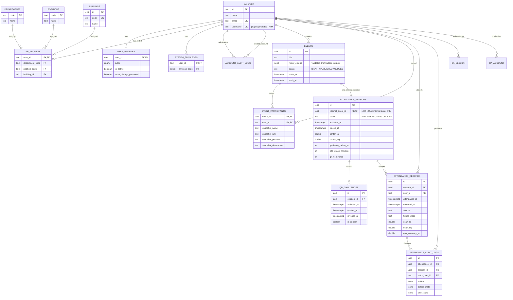

# RESORA — Data Model & Schema Specification (NEED-001)

**Version:** 0.9 · **Updated:** 2026-10-12 · **Status:** Phase 4/4.5 PM-accepted; Phase 5 migration/PostgreSQL verified Development; Phase 6 migration/targeted PostgreSQL verified Development with live-role gaps; Phase 7 quality review\
**Target:** pilot presensi internal SR, 2026-10-18  
**Canonical repository path:** `docs/modules/need-001/resora-need-001-data-model.md`\
**Companion:** [NEED-001 PRD](prd.md), [architecture](../../architecture.md), [acceptance tests](acceptance-tests.md), [roadmap](roadmap.md)

> **Scope:** logical PostgreSQL/Drizzle design, **not executable migration SQL**. Do not run migrations from this document. Better Auth's **actual schema contract** takes precedence for its four core tables and optional shared limiter model (§3). Preserve pnpm 10.33.4 package management, Bun 1.3.13 Express runtime, Next.js/tRPC/Drizzle/Better Auth and Varlock; Supabase is managed PostgreSQL accessed **through Express only**. Do not use Supabase Auth or direct browser/database connections.

Sections 1–11 describe the current design baseline. Sections 12–18 preserve historical Phase 2–3 reviews and test evidence, including superseded audience/event-bound proposals; they are not the current domain schema specification. Phase 4 implemented event/session/QR; Phase 5 adds record/check-in definitions below. Phase 6 audit/manual/report follow the final rules and implementation described in section 21; migration is now applied to Development as recorded below. Historical sections retain their original evidence/status.

## 1. Decisions and semantics

| Area              | Policy / design                                                                                                                                                                                      | State                                                |
| ----------------- | ---------------------------------------------------------------------------------------------------------------------------------------------------------------------------------------------------- | ---------------------------------------------------- |
| Identity          | Exactly one primary actor per account (`SR`, `MAHASISWA`, `ASUS`, `DITMAWA`, `SYSTEM_ADMIN`); pilot login accepts SR and explicitly privileged SYSTEM_ADMIN                                                                                           | Confirmed                                            |
| SR                | One department, one position, one building, active state; NIM login through Better Auth Username Plugin                                                                                              | Confirmed                                            |
| System permission | `SUPERADMIN` granted to a specifically authorized account; **not** an actor; SYSTEM_ADMIN is the dedicated account actor (SA-03). Initially only superadmin changes SR assignments and active status | Confirmed |
| Event audience    | Composable roster of active SR: all SR, one/multiple departments, all KADEP across departments, individuals, explicit include/exclude and deduplication; INTI department and INTI + non-INTI KADEP union | Confirmed |
| Event organizer   | SR belonging to HCO can create event, show QR, view/export attendance; **KADEP HCO or explicit eligible SUPERADMIN** can input/correct manual attendance                                                                        | Confirmed                                            |
| Participant list  | Persist per-event eligible participant roster **at publication** to preserve historical reports and absent invitees                                                                                  | **Confirmed business rule; table design proposed**    |
| Attendance session | NEED-001 has one session per event, with explicit activation/closure separate from publication/schedule; shared engine for later Adaptif activities | Confirmed Phase 4 internal_event_id UNIQUE NOT NULL FK; future Activity binding deferred |
| Attendance scan   | Valid for an eligible authenticated user while attendance session and current QR are active/valid; NEED-001 allows scans before `starts_at` and after `ends_at` | Confirmed |
| Timing            | `EARLY` if before event start; `ON_TIME` from start through 15-minute grace (configurable); `LATE` after grace                                                                                       | Confirmed                                            |
| QR                | Challenge belongs to an attendance session; static/redisplayable during configured TTL, default 360 minutes from challenge activation; explicit revoke/reissue, no automatic rotation | Confirmed; Phase 4 static signed protocol implemented |
| Geofence          | HCO selects map pin or latitude/longitude center; separate configurable radius, **20 m confirmed default**; browser requests location; backend validates distance from untrusted/imperfect GPS | Confirmed; Phase 5 accuracy <=20 m confirmed; operational radius bounds/retention remain open |
| Manual entry      | KADEP HCO selects an invited person by name/NIM; `attendance_at` defaults to server time but can be overridden; `recorded_at` is actual immutable server write time, plus mandatory reason and actor | Confirmed                                            |
| Non-attendees     | Derive presence via report **LEFT JOIN** over invitation snapshots; do not insert fake attendance rows                                                                                              | Confirmed Phase 6                                    |
| Export            | Include every invited participant, attendance timestamp/status, time classification and lateness; exclude secrets and raw GPS coordinates                                                            | Confirmed                                            |
| Email             | Real SR email; planned backend Gmail SMTP display name `RnD SR XIV`; sender address/credentials in env. Recovery/verification in Phase 2 | Confirmed; operational setup TBD |

### Non-negotiable implementation principles

- PostgreSQL `timestamptz` for instants; display `Asia/Jakarta` in UI. Store NIM as **text**, never an integer.
- All authorization, QR token verification, event eligibility, duplicate checks, and geofence distance checks happen on the **backend**. The Phase 4 HMAC protocol is reused by Phase 5 check-in; storage and concurrency require migration review/local PostgreSQL validation before remote application.
- Runtime uses `DATABASE_URL` (Supabase Session Pooler); migration tooling prefers `DIRECT_DB_URL`, reports IPv6/network failures explicitly and never silently retries another connection. [Setup](../../setup.md) documents deliberate pooler alternatives. Local Docker PostgreSQL is optional; VPS deployment planned.
- `attendance_at` is the **effective time of attendance**; `recorded_at` is **when the record was actually written**, including manual late entry.
- Manual insertions/corrections require append-only audit: KADEP HCO for internal SR, authorized Adaptif for general activities. Do not use destructive delete as a routine correction.
- Never store plaintext passwords, QR bearer tokens or Gmail app passwords. Successful QR GPS evidence belongs only to attendance_records; exclude raw GPS from general responses/reports/exports.
- Include unique constraints and transactions at the **database** level, not only client-side checks.

## 2. ERD — domain overview



**Mermaid note:** `BA_*` represent existing Better Auth-managed tables, not new copies. The event→session edge is the **logical NEED-001 one-session association**, a UNIQUE NOT NULL internal-event FK for Phase 4, not a universal cross-module FK. Shared QR/record storage references `attendance_sessions.id`; record uniqueness is `(session_id, user_id)`. Internal entitlement comes from `event_participants` through the validated session→event binding; general-activity entitlement comes from Activity's public backend interface. Activity-owned tables are deliberately not represented as Attendance-owned tables or universal record FKs. See §4.7 for the current internal binding and future Activity boundary.

## 3. Existing Better Auth tables — reuse, do not duplicate

**Phase 8B infrastructure addition (unapplied):** `rate_limit` is Better Auth 1.7.7 native shared throttle storage, not a business role/session table. Drizzle export `rateLimit` maps text `id` PK, unique nonnull text `key`, nonnull integer `count` and nonnull bigint `last_request` (epoch milliseconds), with a pruning index. Production mode uses this model through the existing adapter; local/test retains memory. Migration `20261013024827_phase8b_auth_rate_limit` adds only this table/index and leaves the six applied migrations unchanged. Keys contain IP/path metadata and must not be included in business responses/exports/logs. See [security/Preview gates](../../setup.md#phase-8b-production-security-readiness--preview-gate).

| Table          | Responsibility                                                                              | Treatment                                                                                                              |
| -------------- | ------------------------------------------------------------------------------------------- | ---------------------------------------------------------------------------------------------------------------------- |
| `user`         | Core id, name, real email, email verification; Username Plugin adds login identifier fields | Let Better Auth CLI generate fields required by actual installed plugin version; verify uniqueness of NIM (`username`) |
| `session`      | Authenticated sessions                                                                      | Better Auth-managed                                                                                                    |
| `account`      | Credentials; its `password` column is auth-managed hashed credential                        | Never write raw passwords directly; use supported Better Auth APIs                                                     |
| `verification` | Auth/email verification/reset tokens                                                        | Better Auth-managed                                                                                                    |

**Phase 2A:** server Username Plugin and compatible generated `username` (nullable, unique) / `display_username` (nullable) fields are present in `packages/db/src/schema/auth.ts`. Plugin normalization is disabled to preserve NIM text; immutableUsername is enabled. Phase 2B implements client integration and active-SR authentication enforcement; Phase 2C implements transaction-bound CSV provisioning. Phase 2A.6 applied and verified the foundation migrations on Development (§15); review any future unapplied migrations before application. Do not add a second application-level NIM column as a competing source of truth unless migration requirements dictate it.

## 4. Domain tables and columns — Phase 5 records implemented; audit/manual deferred

Notation: **PK** primary key; **FK** foreign key; **UK** unique; **NN** not null. `timestamptz` = PostgreSQL timestamp with time zone. Defaults/constraints listed separately. Sections 4.1–4.4 are the authorized Phase 2A baseline defined in Drizzle, validated locally in Phase 2A.5 and applied/verified on Supabase Development in Phase 2A.6 (§15). Sections 4.5–4.8 are implemented by the additive Phase 4 migration, locally applied only. Sections 4.9–4.10 remain future storage proposals.

### 4.1 `user_profiles` — exclusive actor and account operational status

| Column                 | PG type           | Constraint/default             | Note                                                                  |
| ---------------------- | ----------------- | ------------------------------ | --------------------------------------------------------------------- |
| `user_id`              | `text`            | PK, FK → `user.id` CASCADE     | Exactly one profile per provisioned user                              |
| `actor`                | `actor_type` enum | NN                             | `SR`, `MAHASISWA`, `ASUS`, `DITMAWA`, `SYSTEM_ADMIN`                                  |
| `is_active`            | `boolean`         | NN, default `true`             | Backend must reject inactive users even with existing session         |
| `must_change_password` | `boolean`         | NN, default `true` for imports | First-login gate; do not expose protected app actions until completed |
| `created_at`           | `timestamptz`     | NN, default now                |                                                                       |
| `updated_at`           | `timestamptz`     | NN, default now                | Update on mutation                                                    |

Database invariant: actor=`SR` has exactly one `sr_profiles` row and a nonblank auth-owned username; other actors have no SR profile. Phase 2A adds deferred constraint triggers checking final transactional state on actor/assignment mutations and auth username updates. Phase 2C supplies transactional provisioning; an ordinary FK alone cannot enforce the inverse relationship. Auth-only scaffold rows may remain unprovisioned without a profile; every provisioned identity must receive exactly one profile. Authentication authorization is not supplied by these storage constraints.

### 4.2 `departments`, `positions`, `buildings` — canonical organization dictionaries

| Table | Columns/types | Existing constraints |
| --- | --- | --- |
| `departments` | `code` TEXT, `name` TEXT, `is_active` boolean | Code PK; nonblank code/name; active default true |
| `positions` | `code` TEXT, `name` TEXT, `is_active` boolean | Code PK; nonblank code/name; active default true |
| `buildings` | `id` UUID, `code` TEXT, `name` TEXT, `is_active` boolean | Generated UUID PK; unique nonblank code; nonblank name; active default true |

**PM-approved Phase 4 codes (superseding the Phase 3 list):** these lists are the canonical reference for DB dictionaries and CSV inputs, implemented in `packages/db/src/organization.ts`. No new enum, table or migration is required.

| Department code | Name |
| --- | --- |
| `INTI` | Inti |
| `ADAPTIF` | Adaptif |
| `SOSIAL` | Sosial |
| `AKADEMIK` | Akademik |
| `SPIRITUAL` | Spiritual |
| `HCO` | HCO |
| `MEDIA` | Media |
| `RND` | RnD |

| Position code | Name |
| --- | --- |
| `KETUM` | Ketum |
| `WAKETUM` | Waketum |
| `SEKRETARIS` | Sekretaris |
| `BENDAHARA` | Bendahara |
| `KADEP` | Kadep |
| `SEKDEP` | Sekdep |
| `ANGGOTA` | Anggota |

| Building code (TEXT) | Name |
| --- | --- |
| `A` | Gedung A |
| `B` | Gedung B |
| `C` | Gedung C |
| `D` | Gedung D |
| `E` | Gedung E |
| `F` | Gedung F |
| `1` | Gedung 1 |
| `2` | Gedung 2 |
| `3` | Gedung 3 |
| `4` | Gedung 4 |
| `5` | Gedung 5 |
| `6` | Gedung 6 |
| `7` | Gedung 7 |
| `8` | Gedung 8 |
| `9` | Gedung 9 |
| `10` | Gedung 10 |
| `11` | Gedung 11 |
| `12` | Gedung 12 |

There are **8 departments, 7 positions, 18 separate buildings**; numeric-looking building codes remain text. `A1`, `GEDUNG_A` and similar combinations are invalid. Department/position are separate FK attributes with this approved pairing rule: `INTI` accepts only `KETUM`, `WAKETUM`, `SEKRETARIS`, `BENDAHARA`; the other seven departments accept only `KADEP`, `SEKDEP`, `ANGGOTA`. `isValidSrAssignment` in `organization.ts` is reused by CSV validation and Identity directory eligibility; future assignment mutations must reuse it. Existing assignments are not rewritten.

**KADEP replaces KADIV** for new data and active policies, including cross-department KADEP audience and “Inti + KADEP”. New CSV input has no KADIV alias. Existing legacy rows/assignments are not converted automatically; report and review before adjustment. Historical migration/test evidence below retains its original terminology. **Inti means `department_code=INTI`**, not a title heuristic. INTI membership grants no HCO, Adaptif or SUPERADMIN privileges.

The local `org:seed` CLI defaults to preview and requires explicit `--apply`; it uses the existing guarded loopback scratch target. It inserts missing official references transactionally, preserves UUIDs and SR assignments, and reruns without duplicates. Unknown/legacy codes, mismatched names, inactive references or invalid existing department/position assignments abort the whole seed with explicit conflict reasons; nothing is silently overwritten/reactivated/deleted. Dictionary maintenance and assignment/status administration require explicit `SUPERADMIN`; no management endpoint is delivered in Phase 3. Remote seeding requires separate PM approval.

### 4.3 `sr_profiles` — SR organizational assignment

| Column            | PG type       | Constraint/default               | Note                                   |
| ----------------- | ------------- | -------------------------------- | -------------------------------------- |
| `user_id`         | `text`        | PK, FK → `user_profiles.user_id` | Every SR has one current assignment    |
| `department_code` | `text`        | NN, FK → `departments.code`      | Exactly one department                 |
| `position_code`   | `text`        | NN, FK → `positions.code`        | `KADEP` is a position, not actor       |
| `building_id`     | `uuid`        | NN, FK → `buildings.id`          | Exactly one building                   |
| `created_at`      | `timestamptz` | NN, default now                  |                                        |
| `updated_at`      | `timestamptz` | NN, default now                  | Only superadmin may change assignments |

CSV uses official `department` / `position` codes and `building` TEXT code; the importer resolves the active `buildings.code` to the existing UUID `sr_profiles.building_id`. All existing foreign keys remain unchanged.

NIM comes from `user.username` (Better Auth Username Plugin). Do **not** duplicate NIM in `sr_profiles` unless an independently justified immutable institutional-id requirement emerges.

### 4.4 `system_privileges` — explicit superadmin permission

| Column               | PG type                 | Constraint/default       | Note                                                  |
| -------------------- | ----------------------- | ------------------------ | ----------------------------------------------------- |
| `user_id`            | `text`                  | FK → `user.id`, NN       |                                                       |
| `privilege_code`     | `system_privilege` enum | NN                       | Initially only `SUPERADMIN`                           |
| `granted_at`         | `timestamptz`           | NN, default now          |                                                       |
| `granted_by_user_id` | `text`                  | FK → `user.id`, nullable | Nullable only for securely recorded initial bootstrap |

**Composite PK:** `(user_id, privilege_code)`. Bootstrap the first superadmin as a new SYSTEM_ADMIN through the audited non-public CLI, never by elevating an existing SR. No SR profile/organization assignment; explicit grant and active username identity required. Existing explicit SR grants retain SA-01 behavior. `SUPERADMIN` grants explicitly authorized system administration and cross-department operational permissions (SA-01). It is read from DB; eligibility, password change, resource lifecycle, invitation/target validation and audit are still enforced.

### 4.5 `events` — HCO internal event and draft roster builder

| Column | PG type | Constraint/default | Meaning |
| --- | --- | --- | --- |
| `id` | `uuid` | Generated PK | Internal SR event identity |
| `title` / `description` | `text` | Title NN/nonblank; description NN default empty string | Only confirmed editable fields after publication |
| `created_by_user_id` | `text` | NN FK to `user.id` | Active HCO creator; ownership/state checked server-side |
| `roster_criteria` | `jsonb` | NN; validated JSON structure | Composable SR selection, not a single audience enum |
| `status` | TEXT with lifecycle CHECK | `DRAFT`, `PUBLISHED`, `CLOSED` | No cancellation/reopening/republication in Phase 4 |
| `starts_at` / `ends_at` | `timestamptz` | NN; end > start | Scheduled event times, never automatic scan boundaries |
| `published_at` / `closed_at` | `timestamptz` | Nullable until explicit action | Publication/snapshot and event closure |
| `created_at` / `updated_at` | `timestamptz` | NN, default now; update on mutation | Event metadata |

**Confirmed roster capabilities:** select all current active SR; one or several official departments; all `position_code=KADEP` from non-INTI departments; chosen individuals; or combine those selections. Apply explicit manual include/exclude and deduplicate by `user_id`. Preview resolves current active SR and organizational assignments, including individually selected users; an inactive/non-SR account cannot be made eligible by manual inclusion. The implemented set expression is `unique(selected groups UNION manual includes) MINUS manual excludes`; validation must make conflicts visible. Criteria fields: `allSr`, `departments`, `inti`, `kadep`, `individuals`, `include`, `exclude`; group UNION, exclude wins. No generic filter language. Identity excludes inactive/non-SR, inactive references and invalid assignments before the resolver.

**Inti is confirmed:** `department_code=INTI`; **Inti + KADEP** unions that department with every non-INTI KADEP. Individual selections can also include INTI members. The old single `event_audience` enum (`SR/KADEP/ALL_STUDENTS`) is superseded as the main NEED-001 model; this pilot builds an SR roster, not a general-student audience. General activities will use registration eligibility, not that enum.

At publish, resolve the criteria again from a consistent current active SR view and atomically save the final deduplicated invitation snapshot plus publication state. A preview is not a reservation or attendance record. Criteria and schedule become immutable after publish; post-publication invitee amendments remain TBD. Title/description may be edited. Location, radius, grace and QR TTL belong to the associated attendance session's configuration; default values are set in draft configuration. Center, radius, grace and QR TTL are frozen after publication. Only title/description may change. Event/session creation, publication/snapshot and event/session/QR closure each use one transaction.

### 4.6 `event_participants` — historical internal SR invitation snapshot

| Column | PG type | Constraint/default | Meaning |
| --- | --- | --- | --- |
| `event_id` | `uuid` | NN FK to `events.id` | Published internal event |
| `user_id` | `text` | NN FK to `user.id` | Invited SR identity |
| `invited_at` | `timestamptz` | NN, default now | Publication-time invitation |
| `snapshot_nim` / `snapshot_name` | `text` | NN for internal SR; nonblank NIM | Publish-time identity for reports |
| `snapshot_department` / `snapshot_position` / `snapshot_building_code` / `snapshot_building_name` | `text` | NN for internal SR | Publish-time department/position codes and building code/name; all required |

**PK `(event_id, user_id)`**, index `(user_id, event_id)`. Publish and snapshot writes are one transaction, with a consistent directory view under concurrent active-status/assignment changes. Changing assignment later never refreshes the historical invitation or its identity/organization values. Inactive accounts remain blocked from authentication/check-in despite an invitation. Snapshot records eligibility, not presence; all invitees remain in recap, including people without records. NEED-007 does not populate this table as a substitute for Activity registration.

### 4.7 `attendance_sessions` — shared attendance window/policy

An attendance session is distinct from an Event and from a Better Auth login session. NEED-001 has **one session per internal event**; `internal_event_id` is UNIQUE NOT NULL FK to `events.id`. Create both rows in one transaction with session INACTIVE. Deferred inverse constraint triggers enforce exactly one session at commit for every event, not only published events; a BEFORE UPDATE trigger forbids rebinding. Do not introduce multiple internal sessions or a generic event registry without an approved requirement.

| Field | PG type / representation | Constraint/default | Meaning |
| --- | --- | --- | --- |
| `id` | `uuid` | Generated PK | QR/record parent |
| `internal_event_id` | `uuid` | NN UNIQUE FK to `events.id` | Internal event owned by Attendance; immutable binding |
| `status` | TEXT with lifecycle CHECK | `INACTIVE` initially, explicit `ACTIVE` / `CLOSED` | Attendance lifecycle separate from event publication/schedule |
| `activated_at` / `closed_at` | `timestamptz` | Nullable until explicit action | Actual session actions, not QR expiry |
| `center_lat` / `center_lng` | `double precision` | Required for NEED-001; latitude -90..90, longitude -180..180 | Geofence center chosen by map pin/coordinates |
| `geofence_radius_m` | `integer` | Positive, default 20 | Separate meter radius; policy frozen at publish; accuracy initially <=20 m on backend |
| `late_grace_minutes` | `integer` | Nonnegative, default 15 for NEED-001 | Inclusive grace measured from internal event start; general-activity timing applicability TBD |
| `qr_ttl_minutes` | `integer` | Positive, default 360 | Each issued challenge expires relative to its own activation |

**Phase 4 PM architecture decision:** Attendance owns internal events and their single session. The current FK is internal-only. Future Activity integration must review its own parent binding/eligibility contract without querying private Activity tables. No Activity tables, shared event registry, polymorphic references or standalone close-session API/UI are implemented now.

Attendance owns session, challenge, record and audit mechanics. The owning business domain resolves the session's event/context and eligibility through a typed **public backend interface**. Internal SR entitlement uses the published snapshot; future Adaptif entitlement uses a successful active/not-cancelled registration exposed by Activity. Attendance must not query Activity's private tables or import its business logic. Frontend uses tRPC through Express, never backend interfaces/DB directly. Domain authorization remains HCO/internal versus Adaptif/general, with explicit eligible SUPERADMIN operational override (SA-01), preserving domain resource/eligibility/integrity checks.

### 4.8 `qr_challenges` — static session-bound QR

| Column | PG type | Constraint/default | Meaning |
| --- | --- | --- | --- |
| `id` | `uuid` | Generated PK | Unpredictable challenge identifier; not sufficient alone as a bearer token |
| `session_id` | `uuid` | NN FK to `attendance_sessions.id` | Required session binding; event is resolved through the validated session association |
| `activated_at` / `expires_at` | `timestamptz` | NN; expiry > activation | Challenge activation + configured TTL, default 360 minutes |
| `revoked_at` | `timestamptz` | Nullable | Explicit immediate revocation |
| `is_current` | `boolean` | NN, default true | Only the current challenge may be used |
| `issued_by_user_id` | `text` | NN FK to `user.id` | Authorized operator for that session's domain |

**Partial unique index `(session_id) WHERE is_current=true`**. Explicit revoke invalidates immediately; expiry invalidates without a lifecycle change. Explicit reissue marks prior challenge non-current and creates a new challenge atomically, using its activation time and configured TTL. Previous tokens stay invalid, even if their original expiry has not passed. No automatic rotation, new session or event reopening is implied. Closed sessions cannot accept scans or receive replacement challenges unless a future approved reopening policy allows it.

Authorized operators redisplay the **same QR for the same challenge** after refresh. Do not store an unencrypted token or rely solely on a one-way hash that cannot support redisplay. **Implemented protocol:** payload `resora:v1:<session_id>:<challenge_id>:<HMAC-SHA256>`, random UUID challenge, domain-separated HKDF-SHA256 signing key derived from backend `BETTER_AUTH_SECRET`, constant-time signature check. Persist only challenge metadata, never the raw bearer token; authorized HCO receives a PNG generated on demand, stable across refresh. Secret rotation invalidates existing signatures. Public backend `verifySessionChallenge` validates signature, exact session binding, published parent, ACTIVE session and current/unrevoked/unexpired challenge. Phase 5 must additionally validate live identity, invitation and geofence in the attendance transaction; QR verification alone is not authorization. Keep signing material/payload out of logs and exports. Cryptographic QR mechanics contain no HCO/Adaptif registration logic.

### 4.9 `attendance_records` — one confirmed attendance per session/user

| Column | PG type | Constraint/default | Meaning |
| --- | --- | --- | --- |
| `id` | `uuid` | Generated PK | Attendance identity |
| `session_id` | `uuid` | NN FK to `attendance_sessions.id` | Shared-engine scope |
| `user_id` | `text` | NN FK to `user.id` | Domain-eligible participant |
| `attendance_at` | `timestamptz` | NN | Effective attendance time; QR uses server clock; authorized manual override permitted |
| `recorded_at` | `timestamptz` | NN, default now; immutable | Actual original record creation |
| `source` | `text` (`QR` / `MANUAL`, CHECK) | NN, `QR` / `MANUAL`; immutable origin | Correction preserves original source |
| `timing_class` | `text` (CHECK) | NN EARLY/ON_TIME/LATE for current internal sessions; future Activity timing remains separate | Derived from internal event start and session grace |
| `recorded_by_user_id` | `text` | NN FK to `user.id` | QR: participant; manual: domain-authorized operator |
| `manual_reason` | `text` | Required/nonblank on manual creation | Correction reasons belong to immutable audit |
| `updated_at` | `timestamptz` | NN, default now; update on correction | Does not replace original creation time |
| `scan_lat` / `scan_lng` | `double precision` | QR NN pair, latitude [-90,90], longitude [-180,180]; MANUAL NULL | One successful QR location measurement |
| `gps_accuracy_m` | `double precision` | QR NN, finite and >0; MANUAL NULL | Measured accuracy; backend initially accepts <=20 m |

**Phase 5 GPS privacy:** store exactly one GPS package only with successful QR attendance; MANUAL has NULL GPS. No failed-scan record, tracking history, raw GPS in general response/recap/export or token logging. Inform SR before permission. Retention and dedicated audit authorization are release gates before Production/real pilot. Phase 5 uses TEXT labels with CHECK constraints, matching Phase 4 conventions instead of introducing the previously proposed enums. Recorded creation time and original source are immutable; later correction/audit remains Phase 6.

**Unique `(session_id, user_id)`**; index `(user_id, attendance_at DESC)`. There is no universal attendance `(event_id, user_id)` key or FK to `event_participants`: registration participants are not internal invitees. Through the validated session binding, internal checks require `(event_id, user_id)` in the snapshot; general checks require Activity's active-registration public interface. These checks must be race-safe in the record transaction. Any additional internal-only DB constraint and the registration-cancellation consistency contract need review with the parent binding; do not pretend one FK targets both eligibility sources.

QR sets effective time to actual server scan time and records creation at server write time; client timestamps cannot override it. Manual entry defaults effective time to current server time, with authorized override and mandatory reason. Do not store synthetic absent records or a separate PRESENT boolean. Correction changes permitted effective fields and inserts immutable before/after audit **in one transaction**, preserving original `source` and `recorded_at`. Duplicate requests never replace timestamps/source; database uniqueness handles concurrent scans/manual entries.

### 4.10 `attendance_audit_logs` — immutable manual/correction history

| Column | PG type | Constraint/default | Meaning |
| --- | --- | --- | --- |
| `id` | `uuid` | Generated PK | Audit identity |
| `attendance_id` | `uuid` | NN FK to `attendance_records.id` | Audited record |
| `session_id` | `uuid` | NN FK to `attendance_sessions.id`; must match record parent | Context/report scope; consistency constraint reviewed with SQL |
| `user_id` / `actor_user_id` | `text` | NN FKs to `user.id` | Participant / authorized operator |
| `action` | `text` with action/state CHECK | NN, `MANUAL_CREATED` / `ATTENDANCE_CORRECTED` | Audited action |
| `before_state` / `after_state` | `jsonb` | Before nullable on creation; after NN | Reviewed fields only, no credentials/QR/GPS secrets |
| `reason` | `text` | NN/nonblank | Required business explanation |
| `created_at` | `timestamptz` | NN, default now; immutable | Audit write timestamp |

Indexes `(attendance_id, created_at)` and `(session_id, created_at)`. Only domain-authorized backend insert/correction services append entries; ordinary UPDATE/DELETE is prohibited. Record mutation and audit insertion succeed/fail together. General Adaptif operators do not inherit HCO's KADEP requirement; internal manual operations remain KADEP HCO only.

### 4.11 `account_audit_logs` — SA-02 account creation

Additive table: UUID `id` PK; `actor_user_id` and NOT NULL `target_user_id` FKs to Better Auth `user.id`; TEXT `action` constrained to `ACCOUNT_CREATED` (real actor required) or `SYSTEM_ADMIN_BOOTSTRAPPED` (NULL actor required, explicit system-bootstrap origin); NOT NULL TIMESTAMPTZ `created_at` default server now. Indexes `(actor_user_id, created_at)` and `(target_user_id, created_at)`. No password/hash/credential metadata column. Table-specific UPDATE/DELETE/TRUNCATE guards keep creation evidence append-only; custom SQL guards are versioned alongside the Drizzle-generated schema snapshot.

SA-02 lists SR accounts (including inactive) and creates one active SR account through the existing Better Auth internal adapter. Valid DB organization references and department/position pairs are required. User, credential, SR/actor profiles and actor/target audit insert commit atomically; deferred identity constraints are flushed before commit. SUPERADMIN is rechecked and share-locked in the transaction, with no inferred/automatic grant. Dashboard temporary passwords are cryptographically generated **24-character** base64url values, returned only after a successful commit and held only in the success screen's memory. The existing CSV contract remains **eight alphanumeric characters**, with its private export/recovery semantics unchanged. Lost response/commit acknowledgement requires checking the account list before retry; this phase does not reset or recover passwords.

SA-02 was accepted by PM. Migration `20261013170324_sa02_account_management` remains unapplied remotely; SA-03 applied it on disposable local PostgreSQL and verified account creation, concurrency, audit guards and profile/audit failure rollback. Offline DB doubles retain service/adapter/hash coverage. No account editing, activation toggle, deletion, password reset, privilege grant or remote account creation is delivered by SA-02.

## 5. State and classification rules

### 5.1 Timing formula (NEED-001)

Use the internal event's immutable schedule and associated session's configured late grace. Publication-time session policy freeze is confirmed; do not silently change already recorded classifications if policy changes. Other contexts' timing rules are not inferred from NEED-001.

```text
seconds_from_start = attendance_at - events.starts_at   (signed seconds)
grace_seconds = attendance_sessions.late_grace_minutes * 60

if attendance_at < events.starts_at:
    timing_class = EARLY
else if attendance_at <= events.starts_at + grace_seconds:
    timing_class = ON_TIME
else:
    timing_class = LATE

minutes_after_start = max(0, floor(seconds_from_start / 60))
minutes_past_grace = max(0, ceil((seconds_from_start - grace_seconds) / 60))
```

The EARLY/ON_TIME/LATE boundary is confirmed; Phase 6 confirms ceiling minutes past grace, zero for EARLY/ON_TIME and NULL for missing attendance. Minutes after start above are explanatory only. Show effective attendance time separately from creation/audit time. Presence and timing are separate; missing attendance has no invented timestamp/class/source.

### 5.2 Event, session and challenge lifecycle

```text
Internal event:    DRAFT -- publish + snapshot atomically --> PUBLISHED
                         PUBLISHED -- explicit HCO close --> CLOSED
Attendance window: INACTIVE -- explicit operator activate --> ACTIVE
                           INACTIVE/ACTIVE -- explicit HCO close event --> CLOSED
QR challenge:     issue -- static/current until expiry, revoke or replacement
```

State names are implemented TEXT labels with lifecycle CHECK constraints. Publication does not automatically activate scans. Activation requires a valid published internal event; the one-session invariant must hold. Session closure disables check-in and invalidates its QR independently of scheduled end. **Internal event closure** must atomically close its associated session and invalidate the current challenge. Expiry/revoke alone does not close session/event. Reissue is an explicit action in an active session and never reopens a closed session/event. No cancel/reopen/republication transitions are invented. No independent close-session endpoint/UI exists in NEED-001. Phase 6 manual lifecycle is PUBLISHED/INACTIVE, PUBLISHED/ACTIVE or CLOSED/CLOSED, never DRAFT; manual operations cannot reopen lifecycle.

### 5.3 Presence and reporting (NEED-001 projection)

| Situation | Derived presence | Timing |
| --- | --- | --- |
| Has record for the event's one session | `PRESENT` | EARLY/ON_TIME/LATE |
| No record, event not explicitly closed | `PENDING` | None |
| No record, HCO explicitly closed event/session | `ABSENT` | None |
| Cancel/reopen or standalone session close before event close | **TBD; do not infer transitions/report projection** | TBD |

Start from **every `event_participants` row**, resolve the event's unique session and LEFT JOIN records by `(session_id, user_id)`. Later organization changes do not change snapshot report values. QR expiry/scheduled end cannot silently produce ABSENT. General-activity reporting/roster comes through Activity's public interface, not this internal invitation table; cancellation must not silently erase recorded attendance/audit.

### 5.4 Publish/scan/manual decision flow

**Preview/publish:** validate HCO through existing protected procedures and live DB identity; resolve active SR plus composable criteria/include/exclude, deduplicate, show preview; revalidate in publication transaction, write `(event_id, user_id)` snapshots and publication state together. Required session association is enforced using the reviewed parent-binding strategy, not a client-provided context.

**QR scan:**

1. Validate Better Auth session, live eligibility and password-change gate. NEED-001 requires active SR; student onboarding for general activities is a separate future dependency.
2. Verify token protocol/session binding and derive domain event/context from trusted backend data. For internal SR, require published/nonclosed event; for every context require active attendance session plus current, unexpired, unrevoked QR.
3. Internal: require published invitation for that session's event. General: use Activity's public backend interface to require current successful/not-cancelled registration. Do not accept client department, owner, registration or eligibility claims.
4. Validate finite coordinates/ranges and accuracy >0 and <=20 m (one backend constant); compute Haversine distance ?session radius on backend. Treat it as untrusted; GPS failure leads to domain-authorized manual handling, not automatic bypass.
5. Within the race-safe record transaction, validate relevant state/eligibility, use server time, classify internal timing and insert with unique `(session_id, user_id)`. Before-start/after-end internal scans are allowed while session and QR remain valid.
6. Only after valid identity, current QR/session, invitation and geofence checks, duplicate/retry returns ALREADY_CHECKED_IN and original time/classification; no timestamp/source/GPS overwrite. Invalid tokens never disclose existing attendance. Lock event then session in the same order as close/revoke/reissue, and revalidate eligibility inside the transaction.

**Manual/correction:** KADEP HCO selects an invited internal participant by NIM/name; Adaptif resolves an eligible general participant through Activity. Use the target session, validate domain/state/participant, require reason and default effective time to current server time. An allowed override changes `attendance_at`, not immutable `recorded_at`; compute internal classification automatically. Correct an existing record instead of adding a second row and append before/after audit atomically, preserving source. KADEP HCO or eligible explicit SUPERADMIN may insert/correct/audit attendance on PUBLISHED with INACTIVE/ACTIVE session or CLOSED/CLOSED, never DRAFT. Effective time must be <= server now and, for CLOSED, <= events.closed_at; CLOSED insertion requires explicit time. No scheduled-end cutoff or extra backdate window. Existing records of inactive historical invitees may be corrected, but new inactive/ineligible insertion is denied. Preserve original recorded_at, source, recorded_by_user_id, initial manual_reason and GPS; update only attendance_at/timing_class/updated_at and append mandatory-reason before/after audit atomically. Manual operations cannot reopen event/session/QR or change snapshots/frozen policy. SA-01 allows explicit SUPERADMIN to satisfy the operator policy without changing department/position; it does not bypass the lifecycle, target, time or audit rules above.

## 6. Constraints and required indexes (future migration review checklist)

Identity constraints are already implemented/applied in Phase 2A; keep their migrations unchanged. The items below concern **future proposed domain SQL**, not permission to implement/apply it.

- [ ] Events: valid schedule order; validated composable criteria and allowed published-field changes; **no single audience enum** as NEED-001 selection model.
- [ ] Participants: PK `(event_id, user_id)`, event/user FKs, index `(user_id, event_id)`; populated SR snapshots; atomic consistent publication without silent later refresh.
- [ ] Sessions: UUID PK; internal-event UNIQUE NOT NULL FK and unique one-session-per-internal-event enforcement, including event creation/commit consistency; active/closed timestamps; no rebinding.
- [ ] Session policy: coordinate ranges, positive radius/TTL, nonnegative internal grace and confirmed defaults; publication freezes all session configuration; permitted operational bounds remain future UAT decisions.
- [ ] QR: `session_id` FK, partial unique `(session_id) WHERE is_current=true`, expiry > activation; signed unpredictable binding and stable redisplay; revoke/reissue/closure concurrency.
- [ ] Records: QR complete finite/range-valid GPS package, MANUAL NULL GPS, immutable recorded_at/source; `session_id`/user FKs, unique `(session_id, user_id)`, own-history index; reviewed context-specific eligibility enforcement, **not a universal FK to invitations**.
- [ ] Audit: record/session/user/actor consistency and indexes, nonblank reason, immutable source/creation, append-only audit; atomic manual mutation/audit.
- [ ] Live session/active-identity/password gate plus HCO, KADEP HCO or Adaptif domain policy; no frontend claims; explicit SUPERADMIN changes operator permission only, not resource rules.
- [ ] Race-safe publish, session/QR activation/reissue, explicit event/session closure and check-in; registration consistency via Activity public interface for future NEED-007.
- [ ] Internal recap: all invitation snapshots LEFT JOIN the event's one session's records; no fake absent rows; exports exclude secrets/raw GPS.
- [ ] No cascade deletion of historical invitation/attendance/audit as routine operation; cancellation/reopening policy must be approved first.
- [ ] Phase 4 additive Drizzle definitions/SQL locally validated; separate explicit approval before any remote migration. No changes to applied Phase 2 migrations.

## 7. CSV import contract

Input headers are exactly `nim,name,email,department,position,building,is_active` (order may vary). NIM is text with leading zeros preserved; email is normalized lowercase; active status accepts `true`, `false`, `1`, `0`. Organization codes must match §4.2 and active DB references. `department` and `position` resolve code FKs; `building` resolves code to UUID, never an integer or concatenated building identifier.

Phase 2C provisions through supported internal Better Auth APIs in one transaction with actor `SR`, imported active status and `must_change_password=true`. Dry-run does not mutate data; repeated identical imports skip existing accounts without resetting passwords or exporting old credentials. Conflicts reject the entire batch. Each new account receives an exactly eight-character cryptographically random alphanumeric temporary password; the single private/ignored `credentials.csv` contains `nim,name,email,temporary_password`. Existing write-before-commit/recovery handling and permanent-password policy are unchanged. See [setup/provisioning](../../setup.md#phase-2c-internal-csv-provisioning-local-synthetic-imports-only). Real imports/distribution remain an explicit approval gate; use synthetic data locally.

## 8. Server-side authorization (Phase 3)

Every operational policy requires a valid Better Auth session and completion of mandatory password change. The principal is an active SR with complete identity/valid assignment, or active SYSTEM_ADMIN with nonblank username and explicit SUPERADMIN grant. Participant/personal SR policies exclude SYSTEM_ADMIN. `sessionProcedure` reloads current identity from Drizzle; `protectedProcedure` enforces the password gate before a domain policy uses `ctx.identity`. Client role/organization/privilege claims are never authority.

| Operation | Required DB identity beyond the shared gate |
| --- | --- |
| Personal SR features | No additional organizational privilege |
| Manage internal SR events, roster, QR/session, view/export internal recap | `department_code=HCO` or explicit eligible SUPERADMIN |
| Insert/correct internal SR attendance manually | `department_code=HCO` **and** `position_code=KADEP`, or explicit eligible SUPERADMIN |
| Operate general Adaptif activities, including manual attendance/correction | `department_code=ADAPTIF` or explicit eligible SUPERADMIN; KADEP is not required |
| Administer SR assignments/active status | Explicit `SUPERADMIN` row in `system_privileges` |

`SUPERADMIN` is neither an actor nor an inferred position/department benefit. RnD membership alone grants nothing. SA-01 explicitly grants active eligible SUPERADMIN all existing operational policies, including HCO manual/audit and Adaptif operations. Without that grant, KADEP from another department and HCO ANGGOTA/SEKDEP cannot perform HCO corrections. Authentication/password gates, valid assignment, resource state, invitations/target eligibility, integrity and audit remain mandatory; own history still uses the session user only.

Implemented pure functions are `canAccessPersonalSr`, `canManageInternalEvent` (shared HCO foundation for roster/QR/recap), `canManageInternalAttendanceManually`, `canOperateGeneralActivity`, and `hasSuperadminPrivilege` in `packages/api/src/modules/identity/identity-policy.ts`. These consume server-validated identity after protected procedures, not client input. Phase 4 real Attendance endpoints reuse the HCO policy through Identity's public backend interface; no identity-admin endpoint is added merely to exercise policies. Resource ownership/context, event state, invited/registered participants, reasons and immutable audit remain mandatory checks when real modules are implemented.

**SA-01 implementation:** `identity.session` projects operator permissions and gated `isSuperadmin` from the current DB identity. Transactional event/QR/manual guards use Identity's public `getLiveOperationalIdentity`, re-reading and share-locking current eligibility and explicit privilege after lifecycle lock waits; no stale privilege is merged into the new identity. A revoked privilege stops access on the next request without login renewal. Creator, recorder and audit actor remain the actual authenticated user. Dated Phase 3/4/7 no-bypass evidence below is historical and superseded by SA-01; it is not the current authorization policy. No schema/migration change is needed.

Disallow raw browser DB access; runtime queries go through Express/Drizzle. No Supabase Auth, service-role key or frontend DB client is introduced.

## 9. Implementation sequence (for Codex after schema approval)

1. **F2 auth:** Better Auth Username Plugin, generated auth schema, `user_profiles`, SR dictionary, `sr_profiles`, `system_privileges`, import from synthetic roster; password flows + Gmail SMTP later in F2.
2. **F3 RBAC:** identity context, HCO/KADEP HCO/Adaptif/explicit SUPERADMIN policies and local official dictionary seed implemented; domain endpoints remain future work.
3. **F4 event/session:** PM FINAL authorizes INTI pairing, internal-only session FK, atomic creation/publication/closure and static signed session QR. Implemented on review branch; local migration validation only, no remote application.
4. **F5 scan:** `attendance_records`, HMAC verification, geofence and timing classification, idempotent insertion.
5. **F6 manual/export:** `attendance_audit_logs`, effective vs recorded time, event participant LEFT JOIN report and CSV export.
6. **F7–F8:** integration tests, real GPS mobile test, email/send safety checks, migration repeatability, deploy/UAT.

Do not implement every table at once if incremental migrations can be safely deployed. Preserve Better Auth-generated schema authority and Drizzle RC-compatible APIs from the actual repo.

## 10. Decisions to close before implementation / production

| ID   | Open item                                                                                               | Impact                                                |
| ---- | ------------------------------------------------------------------------------------------------------- | ----------------------------------------------------- |
| D-01 | Cancellation/reopening/republication handling; title/description-only published edits are confirmed                     | `event_participants` lifecycle and historical reports |
| D-03 | QR TTL/grace bounds; radius range and accuracy tuning after field testing (initial maximum 20 m confirmed)                       | Validation policy and UAT                             |
| D-04 | Closed-event reopening policy (explicit expired/revoked QR reissue is already confirmed)                                                            | HCO event operations                                  |
| D-05 | Phase 6: no future effective time, CLOSED <= closed_at and explicit CLOSED insert time; no extra backdate window | Audit and fraud controls                              |
| D-06 | Gmail SMTP sender configuration, recovery/verification policy and secure temporary password delivery      | Account readiness                                     |
| D-07 | Actual SR roster and approved distribution; optional default center presets     | Pilot real-data import                                |
| D-08 | Attendance/GPS/audit/export retention, dedicated raw-location audit access and export-access logging; WIB/lateness rounding confirmed Phase 6 | Compliance and historical reporting |
| D-09 | Future Activity/session parent binding and race-safe registration eligibility contract | Before NEED-007; Phase 4 internal binding approved |
| D-10 | Phase 6 manual lifecycle confirmed; future cancel/reopen remains out of scope | Before affected future endpoints; no standalone close-session in NEED-001 |
| D-11 | General-activity timing applicability and eligible report interface; exact registration-cancellation/check-in consistency | NEED-007 later; do not force internal invitation/timing rules |

Until approved, don't silently convert these proposal-level details into product requirements. Implementation may use safe technical defaults with explicit review gates only where user-approved behavior is not affected.

## 11. Acceptance data examples (synthetic)

Internal event `E` starts **13:00 Asia/Jakarta**; its sole attendance session `S` has **15 min** grace and is activated at 12:00. Challenge `Q1` references `S`, activates at 12:00 and expires 18:00 (360 min). All examples satisfy live auth/password gate, invitation `(E, U)`, active session, geofence and token checks. Attendance uniqueness is `(S, U)`, not a universal event/user key.

| Effective attendance  | Presence | Timing  | Minutes after start | Minutes past grace | Source |
| --------------------- | -------- | ------- | ------------------: | -----------------: | ------ |
| 12:45                 | PRESENT  | EARLY   |                   0 |                  0 | QR     |
| 13:00                 | PRESENT  | ON_TIME |                   0 |                  0 | QR     |
| 13:10                 | PRESENT  | ON_TIME |                  10 |                  0 | QR     |
| 13:15                 | PRESENT  | ON_TIME |                  15 |                  0 | QR     |
| 13:16                 | PRESENT  | LATE    |                  16 |                  1 | QR     |
| 13:25                 | PRESENT  | LATE    |                  25 |                 10 | QR     |
| No scan, event open   | PENDING  | —       |                   — |                  — | —      |
| No scan, event closed | ABSENT   | —       |                   — |                  — | —      |

If HCO revokes Q1 and explicitly issues Q2 for the same active session, Q1 stays invalid and Q2 receives activation + configured TTL; refreshing Q2 redisplays the same QR. This does not create another session or permit another `(S, U)` record. Closing E closes S and invalidates Q2 atomically; absent reporting still begins from all `(E, U)` invitation snapshots.

Manual example: KADEP HCO saves at 17:00 but sets effective presence at 13:05. Persist `attendance_at=13:05`, `recorded_at=17:00`, `source=MANUAL`, `timing_class=ON_TIME`, actor KADEP HCO, non-empty reason, and immutable audit row. Never retroactively rewrite the initial `recorded_at`.

## 12. Repository compatibility review (2026-10-10)

**Phase 2A review (updated after the documentation baseline):** reviewed `packages/db/src/schema/auth.ts`, schema exports, `packages/auth/src/index.ts`, package scripts, `pnpm-workspace.yaml` and the Phase 1 baseline migration. The repository now defines four Better Auth tables with generated username fields and the six identity tables in §4.1–§4.4. Phase 2A.5 applied/introspected all three migrations locally; Phase 2A.6 applied and verified the same chain on Supabase Development (§15). Event/QR/attendance tables remain proposed. Phase 2A changes schema definitions, auth plugin configuration and migration/test files; environment/connection/package-manager configuration is preserved.

| Coverage / discrepancy | Actual repository or current proposal | Suggested correction / review gate |
| --- | --- | --- |
| Better Auth core keys and relations | Text PKs on `user`, `session`, `account`, `verification`; unique email/session token; session/account `user_id` NN FK to `user` with cascade; user/identifier indexes | Reuse generated names/types/relations; do not duplicate Better Auth tables |
| Better Auth nullability/defaults | User name/email NN; email_verified NN default false; image nullable. Session expiry/token/user NN, IP/user-agent nullable. Account IDs/provider/user NN, password/tokens/scope/expiry nullable. Verification identifier/value/expiry NN. Creation defaults exist; session/account updated_at are NN with application on-update but **no database default** | Preserve auth-owned credential/token semantics; exercise provisioning through supported APIs rather than raw inserts that assume defaults |
| Username/NIM | Server Username Plugin enabled; generated nullable username/displayUsername fields and unique username present | Phase 2A generated/reviewed compatible fields; deferred integrity SQL requires nonblank username for SR. Preserve NIM as text. Do not hand-copy the conceptual ERD as executable auth schema |
| Authentication policy | Config now includes Username Plugin; signup denial, active-account authorization, first-password-change enforcement and email callbacks are not implemented in Phase 2A | Phase 2 implements NIM login, server-side signup denial, secure provisioning/password change, active-account enforcement and planned Gmail flows; do not treat core tables as completed authentication |
| Actor/SR identity and active state | Actor/active/password-change flags and SR profile defined; auth enforcement remains pending | PK/enum/FKs and deferred SR consistency implemented in versioned SQL validated locally in Phase 2A.5; future provisioning must write complete identity transactionally. Reject inactive authentication/existing-session actions/check-in even if snapshotted |
| Superadmin and dictionaries | Privilege composite PK and dictionary references defined; no bootstrap/grant/maintenance service implemented | Review controlled bootstrap and explicit grant access. Only superadmin changes SR assignments/active status initially. Other position/building values await actual CSV; no blanket attendance bypass |
| Dictionary required fields | Building code/name now NN/nonblank; SR inverse actor condition supplied by deferred integrity migration | Authorized Phase 2A adopts the documented clarification; explicit synthetic tests cover constraints, with local database execution passing in Phase 2A.5; Supabase application still requires approval |
| Invitations and inactive users | Publication snapshot is now **CONFIRMED**, while table/field implementation remains proposed; composite `(event_id,user_id)` PK and user-event index documented | Atomic publish + eligible roster snapshot; preserve all invitees in reports. Snapshot cannot override live inactive status. Snapshot NIM/organization fields nullable for future actors; require populated SR snapshots in pilot validation |
| Event policy | Proposed NN schedule/center, defaults 20m/15min/360min, positive/range checks; publish/close timestamps nullable | Validate coordinate center separately from meter radius, schedule order and default policies. **PROPOSED:** conditional published_at/closed_at consistency checks. Audience/schedule immutability and explicit HCO close are confirmed; center/radius/grace freeze still proposed; scheduled end cannot close active QR scanning |
| QR validity | Proposed activation/expiration NN, revoked_at nullable, event/issuer FKs, partial unique current challenge | Preserve static default six-hour activation lifetime/revocation. HMAC reconstruction and random UUID challenge IDs are proposed protocol details; require unpredictable event-bound token, not guessable ID alone. Explicit expired/revoked reissue using configured TTL is confirmed; closed-event reopening remains TBD |
| Attendance identity and time | Proposed unique event/user + composite invitation FK, effective attendance_at NN, immutable recorded_at default now; source/timing NN; manual reason conditional | Implement only after review; reason must be nonblank for manual insert/correction. Compute timing with inclusive tolerance; preserve recorded_at on correction. Presence derived from invitation LEFT JOIN, separate from timing |
| Audit and provenance | Proposed append-only audit with mandatory reason, before nullable only on insertion, after NN, actor/attendance/event/user FKs and event/record indexes | **PROPOSED strengthening:** enforce audit event/user matches its attendance row (composite FK or validated transaction), restrict updates/deletes, preserve immutable creation time. Corrections must preserve original QR/MANUAL source; audit retains original/new states |
| Historical deletes | Auth child sessions/accounts cascade on user deletion; proposed domain FK deletion behavior is mostly unspecified | **PROPOSED:** restrict deletion of users/events referenced by invitation/attendance/audit; prefer deactivation/archive. Do not propagate auth cascade into attendance history without review |
| Timestamp mapping | Actual Better Auth uses `timestamp()` **without time zone**; proposed domain instants use `timestamptz` | Preserve auth-generated schema unless a reviewed compatible migration is separately approved. Explicitly handle UTC conversion and Asia/Jakarta display; test interoperability rather than silently changing auth columns |
| Reporting | Proposed LEFT JOIN covers invited non-attendees; classification examples correct at start/grace boundary | Required CSV contains NIM/name, appropriate organization snapshots, presence, effective timestamp, timing, lateness duration and source; no passwords, sessions, QR secrets or raw GPS. Duration basis/rounding and cancellation projection await review; explicit HCO closure is confirmed |

**Additional TBDs:** backdated manual entries for currently inactive invitees; manual correction after closure; canceled-event reporting. Original attendance source preservation on correction is confirmed. These supplement §10 without changing confirmed rules. `CLOSED` storage, HMAC and the report projection mechanism remain proposals; pending-to-absent at attendance-window closure is confirmed. Do not implement proposal details as approved policy by implication.

**Readiness:** confirmed requirements and acceptance cases support a reviewed Drizzle schema plan and Phase 2 authentication design. Resolve affected TBDs before implementing those behaviors; review the proposed schema/constraints and generated auth changes before any migration. Phase 2A.5 local validation passed; stop for explicit approval and target review before applying to Supabase. Phase 1 connectivity and pnpm verification remain recorded in [setup](../../setup.md) and [migration report](../../pnpm-migration.md).

## 13. Phase 2A identity foundation implementation record

**Scope:** server Username Plugin, generated compatible auth fields, six Drizzle identity tables, relations, PK/FK/index/check constraints, versioned additive SQL and synthetic tests. No UI, event/QR/attendance tables, SMTP, CSV provisioning, authentication authorization flows or application RBAC services. Those remain future work. Active/password-change flags and superadmin grants are storage foundations, not enforcement of those actions by themselves.

### Migration chain (unapplied at Phase 2A; validated locally in 2A.5 and applied to Development in 2A.6)

1. Existing `20261010093513_phase1_scaffold`: untouched SQL/snapshot creates only `user`, `session`, `account`, `verification`.
2. `20261010114142_phase2a_identity`: adds username/display_username and unique username; creates actor/privilege enums, six identity tables, required/unique dictionary fields, assignment/grant FKs and indexes. No duplicate auth creation, drops, data deletes or auth timestamp conversion. Composite/table PKs imply NOT NULL in PostgreSQL even where generated SQL omits an explicit clause.
3. `20261010114235_phase2a_identity_integrity`: custom SQL adds one function and three deferred constraint triggers. SR requires exactly one assignment and nonblank auth-owned NIM; non-SR requires none. Both old/new identities are checked on reassignment. Parent locks serialize checks; rejected inconsistent transactions must roll back. Function is invoker-security with fixed search_path and qualified tables. See [PostgreSQL constraint triggers](https://www.postgresql.org/docs/current/sql-createtrigger.html).

All directories contain SQL and snapshot metadata. The custom trigger/function definitions are deliberately tracked in custom SQL, not represented by Drizzle snapshots; preserve them in later migrations. Existing Better Auth timestamp/default/cascade semantics are retained. Domain instants use timestamptz. No dictionary data, real identities or superadmin are seeded. SR/dictionary/grant references use non-cascading FK defaults, except canonical user_profiles → auth user CASCADE; removal of referenced identities/dictionaries is constrained. Database permissions for future superadmin operations are not created here.

### Generation and review commands

- `pnpm run auth:generate`: Better Auth CLI 1.7.7 generated username fields; reviewed against installed Better Auth 1.7.7. Existing script now pins `auth@1.7.7` to avoid future CLI drift. Initial pre-generation schema-mismatch diagnostic was expected. Preserve generated semantics; normalize formatting minimally.
- `pnpm run db:generate --name=phase2a_identity`: generated additive migration from the unchanged Phase 1 snapshot; no database connection/query.
- `pnpm run db:generate --custom --name=phase2a_identity_integrity`: generated custom migration directory, then reviewed cross-table integrity SQL added.
- `pnpm run db:generate --name=phase2a_verify`: reports **no schema changes**; adds no files. Confirms generated snapshots and source remain aligned.
- Host Varlock commands used the existing optional session telemetry workaround from setup. No env files, DATABASE_URL/DIRECT_DB_URL handling or lockfile/dependency versions changed.

### Tests and migration readiness

| Command/check | Phase 2A result |
| --- | --- |
| `pnpm run test:identity` | 10 offline tests pass, 90 assertions. 23 local PostgreSQL cases intentionally not executed (Bun reports 25 skips including hooks); no scratch URL was supplied |
| `pnpm run test:smoke` | Existing four connectivity unit tests pass; no database connection acquired |
| `pnpm run check-types` | All six workspace tasks pass |
| `pnpm run build` | Both Express and Next.js production builds pass using existing Varlock telemetry workaround |
| Targeted read-only Biome | Nine identity/source/snapshot files pass normal checks; auth schema/root/server manifests pass with formatter disabled to preserve existing formatting |
| `pnpm run lint --max-diagnostics=5 --reporter=summary` | Fails on remaining scaffold formatting/import/accessibility issues: 86 errors, 69 warnings, 1 info; no whole-repo fixes applied |
| `git diff --check`, Markdown links/table/fence checks | Pass: 11 changed Markdown files, 42 internal links/anchors, 37 tables, balanced fences and AT-001–049; protected integration/baseline/lockfile/frontend files unchanged |

Initial Bun/pnpm commands hit Windows sandbox EPERM/EACCES resolving pnpm links/CLI cache; approved retries passed. Generation's expected pre-refresh username-field diagnostic was resolved by the generated fields. An initial migration-chain test incorrectly treated `.gitkeep` as a migration directory; restricting it to the three foundation migrations fixed the test. Targeted auth import ordering was corrected. No dependency upgrades or live database operations were used to resolve these issues.

Run `pnpm run test:identity` for offline plugin/schema/SQL/chain checks using synthetic fixtures. Local PostgreSQL tests are opt-in via **RESORA_IDENTITY_TEST_DB_URL**, accept only loopback `resora_identity_test_*` databases without URL options, and never read DATABASE_URL/DIRECT_DB_URL or run DDL/migrations. They require the complete reviewed migration chain already applied manually to that disposable database; ordinary cases roll back synthetic data; commit-boundary probes explicitly clean their committed synthetic fixtures. Guards reject Supabase and ordinary application DB names. Do not point tests at Development or production.

After review and separate approval/manual application of the chain to that local scratch database, privately set the test URL, run tests and restore the previous variable value:

```powershell
# Placeholder only; use your private loopback scratch connection after review.
$env:RESORA_IDENTITY_TEST_DB_URL = '<loopback URL for resora_identity_test_review>'
pnpm.cmd run test:identity
# Remove this override if it was previously unset; otherwise restore its prior value.
Remove-Item Env:RESORA_IDENTITY_TEST_DB_URL
```

**Phase 2A readiness (historical; superseded by §14):** SQL ready for review, not approved/applied or validated on PostgreSQL at that phase. Before applying anything, review this chain and custom triggers; verify the target has no existing tables/migration history requiring reconciliation; obtain approval. After review, apply to an explicitly selected disposable local database and run the opt-in integrity suite before considering a separately approved Development migration. Use the existing Varlock/direct connection preflight and explicit Session Pooler alternative in [setup](../../setup.md); do not use db:push or silently switch connections. No migration ran in Phase 2A.

## 14. Phase 2A.5 local PostgreSQL validation

**Date:** 2026-10-10 (Asia/Jakarta). **Authorization:** this phase explicitly authorized disposable local migration application/testing. Supabase Development and production were not connected to or modified. No schema, migration SQL/snapshot, dependency, lockfile, environment file or application feature changed.

### Environment and safety audit

- Windows native PostgreSQL **18.3**, using the existing installation at `C:/Program Files/PostgreSQL/18/bin`. Bun **1.3.13**, pnpm **10.33.4**, installed Drizzle Kit/ORM **1.0.0-rc.4** retained.
- Docker Desktop was running, but `docker info` hung and returned HTTP 500 from the Linux Engine API. No Docker pull, container start, prune or disk repair was attempted. Host free space before setup: approximately **16.4 GiB C:** and **83.2 GiB E:**. Native PostgreSQL provided a working alternative.
- Dedicated cluster: ignored `tmp/phase2a5-postgres/data`; bound only to **127.0.0.1:55432**, UTC timezone, role `resora_identity_test`, database **resora_identity_test_phase2a5**. Local trust authentication was limited to this disposable loopback cluster, which is stopped after validation; do not use it for shared/deployed resources. Retained scratch files are ignored for review/reuse.
- Verified server address/port/version before database creation, then verified the exact database name and zero public tables before migration DDL. Process overrides set **both DATABASE_URL and DIRECT_DB_URL** to the scratch target. A temporary guard verified Varlock resolved both overrides exactly; no Supabase fallback occurred. All overrides were restored and URLs/credentials withheld from logs.
- Native `pg_ctl` startup and pnpm-linked imports needed approved execution outside the Windows sandbox. Temporary PowerShell execution policy applied only to the wrapper process; machine policy was not changed. A Windows inline-argument quoting failure was resolved with a temporary source file before migrations ran.

Audit: Phase 1 creates four auth tables before adding their FKs. Identity enums precede their columns; all six identity tables exist before assignment/grant FKs are added. Username columns/uniqueness ALTER the existing auth table. PKs enforce non-null identities (including the composite privilege key); all indexes and checks are additive. The final migration creates the function before three AFTER ROW, DEFERRABLE INITIALLY DEFERRED constraint triggers. Trigger checks use final transactional state, qualified public tables and parent locks. No duplicate table creation or destructive SQL was found.

### Execution and evidence

| Check / command | Result |
| --- | --- |
| Native `initdb`, `pg_ctl`, guarded local `createdb`, target `SELECT` | Isolated PostgreSQL cluster and empty scratch database prepared successfully |
| `pnpm --dir packages/db run db:migrate` | Existing Varlock/direct preflight passed SELECT 1; all three versioned migrations applied in order |
| Catalog/history validation | Ten public tables; two enums; ten PKs, nine validated FKs, four unique constraints, six checks; 22 valid indexes; generated nullable text username/display_username; three deferred triggers |
| Drizzle history | `drizzle.__drizzle_migrations` contains exactly three entries; ordered names, SHA-256 file hashes and timestamp keys match `readMigrationFiles`; applied_at populated |
| Second `pnpm --dir packages/db run db:migrate` | Success with identical object OIDs, constraints, indexes, triggers, function definition and history rows; no duplicated objects or history edits |
| Local `pnpm run test:identity` | **38 passed, 0 failed, 0 skipped; 154 assertions**: 28 PostgreSQL cases plus ten offline plugin/schema/guard tests |
| Default `pnpm run test:identity` after stopping scratch DB | **10 passed, 0 failed; 30 skips** (28 PostgreSQL cases and two hooks); verifies opt-in behavior without any database fallback |
| `pnpm run test:smoke` | **4 passed**, 0 failed; 11 assertions |
| `pnpm run check-types` | All **six** workspace tasks passed |
| Targeted read-only Biome | Nine relevant source/test files passed; formatting was applied only to the edited integration test before the read-only check |
| Full read-only Biome | `pnpm run lint --max-diagnostics=5 --reporter=summary`: **86 errors, 69 warnings, 1 info**, all remaining scaffold issues; no unrelated fixes applied |
| Documentation/diff checks | Nine Markdown files, 43 internal links/anchors, 37 tables and balanced fences pass; `git diff --check` passes; migration/runtime/lockfile configuration unchanged |
| Build | Not repeated: changes are tests/documentation only; Phase 2A app builds passed and no runtime/schema configuration changed |

**Defect and minimal fix:** Bun 1.3.13's `.rejects.toMatchObject()` stalled pg query/protocol progress, then rollback hooks timed out and later tests could not acquire the single pooled client. A minimal SELECT 1/0 + rollback reproduction succeeded in Bun and Node with ordinary try/catch, but timed out with that Bun rejection matcher. `identity.integration.test.ts` now awaits query failures normally and synchronously asserts the same SQLSTATE/constraint fields. No constraints were removed or weakened; SQL required no fix.

Added reusable live catalog/history checks, missing-position/building FK cases, and COMMIT-boundary probes. A complete SR transaction commits successfully; incomplete SR fails at deferred COMMIT and leaves no partial identity. Original negative cases cover non-SR assignments, missing/cleared NIM, duplicate NIM/profile/privilege, required fields and protected dictionary deletion. Ordinary cases roll back; the successful COMMIT probe explicitly deletes its synthetic fixtures. All seven identity/auth-user/dictionary tables were empty after testing.

### Recommendation and remaining gates

**Ready for a separately approved Supabase Development migration**, subject to SQL review and private target/history/recovery checks. Local validation removes the PostgreSQL execution blocker. Docker API health remains unresolved but did not block this phase. Supabase server version, migration-role permissions, direct connectivity/IPv6 and target history were not checked in this local-only phase; validate them deliberately after explicit approval. Never use db:push or fabricate history. Follow the [local reproduction steps](../../setup.md#phase-2a5-disposable-identity-validation) and existing explicit Direct/Session Pooler choices. Authentication enforcement, provisioning, RBAC and pilot/UAT readiness remain later gates.

## 15. Phase 2A.6 Supabase Development migration

**Preflight date:** 2026-10-10 (Asia/Jakarta). **Authorization:** PM explicitly approved this phase against Development only and confirmed project `resora`, reference `unak…nbbo`, matches the configured target. The dashboard browser verification tool was unavailable; target identity uses that explicit PM confirmation plus matching Session Pooler/Direct project references.

### Preflight and recovery plan

- Selected the existing **Session Pooler, port 5432**, database `postgres`, login/database role `postgres`; server PostgreSQL **17.11**. No Transaction Pooler, alternate database, env-file edit or fallback was used.
- Process-only `VARLOCK_TELEMETRY_DISABLED=1` retained Varlock loading/validation. The URL did not specify TLS; process-only `PGSSLMODE=verify-full` initially rejected the untrusted certificate chain. Supabase's public Root 2021 CA was downloaded over HTTPS and inspected (valid until 2031); `NODE_EXTRA_CA_CERTS` supplied it to Bun and Node. The connected TLS socket was encrypted and certificate-authorized. Certificate verification was never disabled. See [Supabase SSL guidance](https://supabase.com/docs/guides/platform/ssl-enforcement).
- Existing Session Pooler `--check` passed `SELECT 1`. Catalog/data checks ran in a **read-only transaction**. Database CREATE, public CREATE/USAGE, PL/pgSQL USAGE and `gen_random_uuid()` EXECUTE privileges passed. All three SQL SHA-256 hashes match the Phase 2A.5 validated version; SQL/snapshot files are unchanged from validation commit `7409a6a`.
- No non-extension public/Drizzle relations, custom functions, public enums, conflicting migration tables/history or unexpected custom schemas exist. `auth.users`, `storage.objects` and `storage.buckets` counts are zero. A conservative schema guard first paused on `pgbouncer`; inspection confirmed no relations and only the managed `get_auth(text)` function, matching [Supabase's published baseline](https://github.com/supabase/postgres/blob/develop/ansible/files/pgbouncer_config/pgbouncer_auth_schema.sql). No credentials or application row contents were queried/exported.
- **Recovery for this empty Development baseline:** the installed Drizzle ORM wraps all pending application DDL and their history inserts in one transaction. On failure, stop, inspect whether that transaction rolled back, and compare catalog/history with this empty baseline. Initial Drizzle tracking schema/table creation occurs outside that transaction and may remain empty; do not drop/reset objects, fabricate history or retry blindly. Any partial/conflicting state requires review before repair. There is no existing application data to restore; managed schemas remain untouched. Dashboard backup/PITR availability was not verified or assumed. After a successful migration, reversal/removal requires a separately reviewed recovery action; this phase authorizes no destructive rollback.

### Execution and post-migration verification

`pnpm.cmd --dir packages/db exec bun run scripts/session-pooler.ts --migrate` **passed** with the process-only telemetry/TLS settings above. The explicit wrapper passed DATABASE_URL as DIRECT_DB_URL only to its child. All three unchanged migrations applied in order; no db:push, SQL Editor migration, reset, schema alteration outside the reviewed files or second migration invocation was used.

| History ID | Migration | created_at key | applied_at (UTC) | SQL SHA-256 |
| --- | --- | --- | --- | --- |
| 1 | `20261010093513_phase1_scaffold` | `1791624913000` | `2026-10-10T15:34:27.644Z` | `01d8d61940f53db3a97c295b6634e1daf10a8db207deff0a3c9c73131e0379e5` |
| 2 | `20261010114142_phase2a_identity` | `1791632502000` | `2026-10-10T15:34:27.644Z` | `6794ce881f717bfa6d5b314c844171931e8503ca847015ff10fd208af3852e5f` |
| 3 | `20261010114235_phase2a_identity_integrity` | `1791632555000` | `2026-10-10T15:34:27.644Z` | `a946a26552850e37865cb28cee6462d6ba15e10d7bfbb036fc2ea1d0f649d21e` |

Read-only post-verification passed:

- Exactly ten public tables: `account`, `buildings`, `departments`, `positions`, `session`, `sr_profiles`, `system_privileges`, `user`, `user_profiles`, `verification`; all have zero rows. No synthetic or real accounts were created.
- Username/display_username are nullable text; username is unique. Actor enum has SR/MAHASISWA/ASUS/DITMAWA; SUPERADMIN remains a separate privilege enum.
- **10 PKs, 9 validated FKs, 4 unique constraints, 6 validated checks, 22 valid/ready indexes**. Reviewed named constraints, FK columns/targets/delete behavior, composite privilege PK and all explicit identity indexes match.
- `user_profiles_sr_consistency`, `sr_profiles_actor_consistency`, `user_sr_nim_consistency` are enabled (`O`), DEFERRABLE and INITIALLY DEFERRED on their expected tables. Function body matches the reviewed SQL, with invoker security and fixed search_path.
- Exactly three `drizzle.__drizzle_migrations` rows; names, hashes, timestamp keys and populated applied_at match `readMigrationFiles`. **Zero pending migrations**; verified from history without rerunning DDL.
- `pnpm.cmd run db:check` **passed** the Express backend's DATABASE_URL `SELECT 1` with verified TLS. No Supabase integrity fixtures were executed; the 38-case local Phase 2A.5 result remains the behavioral evidence.
- `pnpm.cmd run test:smoke`: **4 passed, 0 failed, 11 assertions**, with no database acquisition. Documentation-only diff, all **51 internal links/anchors** across ten changed Markdown files, balanced fences and `git diff --check` passed. Migration SQL/snapshots remain identical to commit `7409a6a`. Build/typecheck/Biome were not repeated for documentation-only changes; Phase 2A.5 results and existing unrelated scaffold lint failures remain recorded in §14.

Initial failures were non-destructive: untrusted TLS chain resolved by explicitly trusting the public CA; conservative managed-schema guard resolved after catalog/source verification; first post-verification attempt stopped on a guard before catalog validation, and a retry with more precise stage reporting passed without changing verification assertions or database state. No SQL defect or migration-file correction was needed.

**Remaining limitations:** configured URLs still omit TLS mode; future commands must deliberately supply the verified TLS/CA settings (see setup). No env files, runtime configuration or machine trust settings were changed. Direct/IPv6 connectivity, production backup/PITR/restore, least-privilege role provisioning and Docker health remain outside this validation. Development identity foundation is migrated and ready for reviewed Phase 2B work; authentication policy/UI, provisioning, SMTP, RBAC and event/QR/attendance remain unimplemented. Stop here for review.

## 16. Phase 2B SR authentication

**Date:** 2026-10-11 (Asia/Jakarta). **Scope:** SR authentication only, using the already applied identity schema. No migration/schema/history/env/dependency change, Supabase connection or remote data mutation. The Phase 2A.6 record above describes that earlier phase, not current authentication readiness.

### Implemented identity behavior

- Better Auth Username Plugin signs in with the exact NIM string; no numeric conversion or username normalization. Public signup, email-login bypass, username availability and public profile/username mutation endpoints are closed. Authorized CSV provisioning is not implemented and must later use an explicitly privileged server/script path.
- Session creation requires a current active `SR` primary actor, nonblank username and joined SR profile. Auth session endpoints, protected tRPC requests and Next.js SSR check current identity, so a stored cookie cannot preserve access after deactivation or actor reassignment. Cookie caching is disabled.
- Existing `user_profiles.must_change_password` gates protected APIs/dashboard immediately after first login. Session inspection/logout/password change remain available. Better Auth verifies the current password, requires a different new password, rotates the session and revokes prior sessions even if a caller asks otherwise; only after success does the backend clear the existing flag. No new column/migration is needed.
- Credential update/session rotation and identity-flag clearing are sequential framework/Drizzle operations, not one shared transaction. If the final flag update fails, the gate stays closed; a user may need to log in with the new password and retry. No success is shown until the frontend rechecks identity. Fault-injection of this database failure has not been tested.
- Backend requires a trusted Origin for HTTP auth mutations. Express overwrites the framework's IP header from the actual socket; the in-memory limiter allows five login/password-change attempts per minute. Generic credential errors do not distinguish wrong NIM/password, inactive, non-SR or missing profile. Logs are disabled for framework auth errors; tRPC internal errors omit driver details/stacks.
- Feature files are shallow: `apps/web/src/features/identity`, `packages/api/src/modules/identity/identity.router.ts`, and `packages/auth/src/sr-access.ts`. Express bootstrap/context inject services for isolated tests. Next SSR calls Express/tRPC; no frontend DB client or Supabase Auth was added. Existing UI components/styles are retained; signup scaffold removed.

### Validation evidence

Reused the approved Phase 2A.5 native PostgreSQL **18.3** scratch cluster bound to **127.0.0.1:55432**, database **resora_identity_test_phase2a5**, role **resora_identity_test**. Read-only preflight verified host/name, three existing migration entries and empty application user table before fixtures. No migrations were run. Tests insert only randomly generated synthetic identities/password hashes and remove their own fixtures; neither runtime DATABASE_URL nor DIRECT_DB_URL is loaded by auth tests.

| Command/check | Result |
| --- | --- |
| `pnpm.cmd run test:auth` with guarded local `RESORA_IDENTITY_TEST_DB_URL` | **16 passed, 0 failed, 0 skipped, 80 assertions**; includes 13 PostgreSQL/HTTP cases and three offline/guard cases. |
| Same command without that variable | **3 passed, 0 failed, 15 skipped** (13 PostgreSQL cases and two lifecycle hooks), 15 assertions; explicit safe skip, no application database fallback. |
| `pnpm.cmd run test:identity` with the same guarded local target | **38 passed, 0 failed, 0 skipped, 154 assertions**. Existing deferred identity constraints preserved. |
| `pnpm.cmd run test:smoke` | **4 passed, 0 failed, 11 assertions**. |
| `pnpm.cmd run check-types` | **All six tasks passed**. First check needed Next route type regeneration after adding `/change-password`; `pnpm.cmd --dir apps/web exec next typegen` resolved stale generated route types. |
| `pnpm.cmd run build` | **Both Express and production Next.js builds passed**, including dynamic `/login`, `/dashboard`, `/change-password`. Varlock retained with process-only telemetry workaround. |
| Targeted `pnpm.cmd exec biome check` | **All 20 changed/new TypeScript files passed**, read-only final check. Only edited code files were formatted. |
| Full `pnpm.cmd run lint --max-diagnostics=5 --reporter=summary` | **Fails: 73 errors, 62 warnings** in existing scaffold formatting/import/a11y and root manifest formatting; unrelated files were not fixed. |
| Local headless Edge smoke | **Seven checkpoints passed**: anonymous protection/NIM text/no signup; invalid credentials; leading-zero login/password gate; password change/dashboard; logout/replay protection; login using changed password; deactivated-account redirect/session state. Production Next.js and actual browser auth client called local Express. |
| Documentation/diff review | Eight Phase 2B Markdown files: **51 internal links/anchors** and balanced code fences passed; four pre-existing relative links in the module PRD corrected. `git diff --check` passed. Schema, applied migrations and package-manager/Supabase configuration unchanged. A concurrent rewrite of AGENTS.md was preserved; implementation status remains in project documentation. |
| Cleanup/catalog | All **ten application tables empty**, exactly **three migration entries** after tests. Browser/Next/Express processes and temporary profile/harness cleaned up; scratch cluster stopped after validation. |

Windows sandbox initially prevented Bun resolving pnpm dependency junctions and PostgreSQL startup; explicit permission was obtained for the same operations. The accidentally denied startup request was repeated unchanged and approved. The browser helper failed; an explicitly approved isolated headless Edge harness completed smoke testing instead. No security configuration, browser sandbox or TLS verification was disabled. The harness was temporary, not a committed browser regression suite.

Negative origin testing found that the Username Plugin could accept an untrusted login Origin before a session cookie existed. The explicit before-hook now rejects missing/untrusted HTTP mutation Origins before credential work; the negative test passes. Other early failures were test dependency location/type projections, stale Next route types and PostgreSQL address formatting (`host(inet_server_addr())` avoids CIDR suffix); fixes did not weaken identity constraints or alter applied SQL.

### Remaining gates and document discrepancy

Phase 2B core authentication acceptance is proven locally and ready for review; this does **not** establish pilot/production readiness. Authorized CSV import, private initial credential distribution, Gmail SMTP/recovery/verification, domain RBAC, long-lived session refresh testing and mobile/HTTPS UAT remain pending. Rate limiting is in memory per process; until a reviewed trusted-proxy configuration exists, reverse-proxied clients share the socket key. SameSite=Lax cookies require a same-site frontend/backend deployment; multiple-worker/proxy/domain configuration needs review.

Latest [system PRD](../../prd.md), [module PRD](prd.md) and [architecture](../../architecture.md) introduce SR-only roster-builder eligibility and session-based shared attendance. The proposed event/audience/QR sections of this model and older ADR/roadmap/acceptance wording predate those decisions. **Do not implement those domain tables from the older design until PM reconciliation.** Identity/auth decisions agree and no event/QR/attendance schema or business rule was changed in Phase 2B. Continue to provisioning only after review; no remote migration is required or authorized by this record.

## 17. Phase 2C SR CSV provisioning

Implemented on `feat/sr-provisioning` from clean/current `main` (`8ded421`), without schema changes, migrations or remote access. CLI entrypoint: `apps/server/src/scripts/provision-sr.ts`; shallow identity domain: `packages/api/src/modules/identity/{provisioning-csv,provisioning-credentials,sr-provisioning}.ts`. [Input/output, commands and recovery](../../setup.md#phase-2c-internal-csv-provisioning-local-synthetic-imports-only).

- Required CSV fields: `nim,name,email,department,position,building,is_active`. NIM remains a string, email is normalized; dictionary codes must exist and be active. Invalid input, duplicate batch identity and conflicts with existing accounts reject the batch. Exact reimports skip existing accounts without changes or credential re-export, including after password change.
- Dry-run uses a read-only transaction and creates no files/accounts. Explicit apply serializes imports with an advisory transaction lock. Better Auth's supported internal `createUser`/`linkAccount` operations and configured password hasher are bound to the same Drizzle transaction as `user_profiles`/`sr_profiles`; deferred constraints are checked before commit. New profiles use actor SR, imported active status and `must_change_password=true`. No system privilege is granted.
- Per the subsequent PM decision, each new temporary password is exactly eight alphanumeric characters (A–Z, a–z, 0–9), sampled uniformly with cryptographic randomInt; batch uniqueness checks remain. Existing account passwords are not reset, and the minimum eight-character permanent-password policy is unchanged. One owner-restricted/Git-ignored CSV per new batch contains `nim,name,email,temporary_password`. Complete exclusive file creation/fsync precedes DB inserts/commit. Private status/count/digest metadata distinguishes committed, failed and uncertain outcomes; credentials are retained for recovery, never logged. This is filesystem/DB coordination with a documented uncertainty procedure, not distributed atomic commit.
- CLI accepts only verified loopback `resora_identity_test_*` databases through `RESORA_IDENTITY_TEST_DB_URL`, with no `.env` or runtime URL fallback. Current release does not authorize/enable Supabase imports. Public signup and all Phase 2B account/session/password policies are unchanged. Existing identity schema supports provisioning; applied SQL/snapshots/history remain untouched.

### Local verification (2026-10-11)

PostgreSQL 18.3 native Windows scratch database `resora_identity_test_phase2a5`, role `resora_identity_test`, loopback `127.0.0.1:55432`, with the existing three migrations; no migration command ran. One primary dummy was provisioned by the actual CLI and checked through Better Auth/Express, first-password-change enforcement and protected dashboard. Temporary additional synthetic fixtures tested failure/bulk/concurrency; all DB fixtures were removed afterwards. Credential exports remain private/ignored for review, including failed/uncertain test exports; these are not live-user handoff files.

| Verification | Result |
| --- | --- |
| `pnpm.cmd run test:provision` | 16 passed (6 CSV/guard, 10 PostgreSQL/CLI cases), 0 failed, 0 skipped; 85 assertions. Includes dry-run, leading zero, hashing/profile/flag, login/password change, inactive denial, reimport, multi-row, invalid input/reference, output failure, late insert rollback, uncertain metadata and concurrent import. |
| `pnpm.cmd run test:auth` / `test:identity` / `test:smoke` | 16 / 38 / 4 passed, 0 failed or skipped; public signup, live account/session policy and deferred integrity preserved. |
| `pnpm.cmd run check-types` | All six workspace tasks passed; API typecheck also passed after test harness changes. |
| `pnpm.cmd run build` | Express and production Next.js builds passed; no dependency upgrade. |
| Optional `RESORA_PROVISION_WEB_SMOKE=1` targeted CLI test after build | 2 passed, 8 intentionally filtered out, 29 assertions. Production standalone Next.js HTTP: anonymous dashboard → login, initial credential session → change-password, changed-password session → dashboard 200. No browser automation. |
| `pnpm.cmd run lint --max-diagnostics=8 --reporter=summary` | 108 files checked read-only, zero errors/warnings after excluding the private operational artifact directory; source rules remain unchanged. |

Initial sandbox dependency/startup failures required explicit escalation. Negative-test `rejects.toThrow` matchers could block Bun/pg I/O; awaiting/catching rejection before matching fixed test timeouts, without relaxing application/database constraints. Transaction queries now run sequentially on their single pg client. An early standalone smoke misread Bun's initially undefined child `exitCode`; the corrected readiness/cleanup check passed using the actual standalone artifact. Restricted `.private` directory permissions also required explicit traversal exclusions for Git/Biome, without weakening ACLs.

**Remaining approval gates:** real roster/organization setup, authorized target expansion and secure credential handoff/retention; Gmail SMTP/recovery/verification; mobile/HTTPS/pilot UAT and subsequent RBAC. The mechanism supports bounded multi-row batches technically today; real data is not a prerequisite for this local implementation. No commit, push, merge or deployment is part of Phase 2C verification.

## 18. Phase 3 RBAC and organization standardization (2026-10-11)

**Implemented/tested locally; PM review/merge pending.** Branch `feat/identity-rbac` was created from clean/up-to-date main after Phase 2C. No schema, applied SQL/snapshot/history, dependency, runtime, public signup or password-policy change.

- Canonical references (section 4.2): 7 departments, 7 independent positions, 18 separate TEXT-coded buildings. KADEP supersedes KADIV for active policy/new CSV; Inti remains TBD. The importer still resolves active DB references and building UUID, preserving transactions, eight-character secure temporary passwords, credentials output and repeat-import behavior.
- One live identity query supplies organization and explicit SUPERADMIN; existing session/active-SR/password gates remain. Pure policies (section 8) are server foundations, without event/attendance/admin endpoints or UI. No implicit RnD grant or SUPERADMIN operational bypass.
- Native PostgreSQL 18.3, loopback `127.0.0.1:55432`, disposable `resora_identity_test_phase3_20261011`. Initialized with the unchanged three versioned migrations. Seed preview reported 7/7/18 missing, apply inserted them, rerun inserted zero. Final counts: 7/7/18 references, zero users/SR profiles/privileges, three migration entries. Synthetic test users were cleaned up; official reference data is retained locally.
- Retained older `resora_identity_test_phase2a5` has synthetic legacy references `SYN_HCO`, `SYN_KADIV`, `SYN_BUILDING` and one assignment/account. These are reported, not converted/deleted or reseeded. Name/legacy/inactive conflicts are tested transactionally on the new scratch database and rolled back.
- `pnpm run test:rbac`: **21 passed**; `test:provision`: **19 passed**; `test:auth`: **16 passed**; `test:identity`: **38 passed**; zero failures/skips. Coverage includes live DB grant/revoke/assignment/deactivation, forged client claims, session/password gate, seed idempotency/conflicts/assignment preservation, official CSV codes, import/password/recovery regression.
- `pnpm exec biome check .`: **114 files, zero errors/warnings**; `pnpm run check-types`: **6 successful tasks**; production Express/Next.js `pnpm run build`: **2 successful tasks**. Initial sandbox build could not fetch Google Fonts; the same command passed after explicit network permission. Initial test type inference and two new-test formatting findings were corrected; `git diff --check` passes.

No Supabase connection/mutation, new migration, real SR import, browser automation, deployment or commit/push/merge. Event/attendance resource-state/ownership/audit checks and old domain-model reconciliation remain Phase 4+ work; this validation does not certify those unbuilt workflows or production/UAT readiness.

## 19. Phase 4 FINAL implementation and local validation (2026-10-11)

PM FINAL authorizes the current internal-only design. INTI is department eight; canonical 8/7/18 reference data and pairing validation are implemented without identity schema/authentication changes. CSV still uses eight-character secure temporary passwords, the existing single credentials CSV, transaction/recovery and no password reset on re-import. Seed reports legacy/invalid assignments without rewriting them; Identity public directory excludes them from rosters.

Attendance owns four new Drizzle tables: events, event_participants, attendance_sessions, qr_challenges. Migration `20261011135412_phase4_attendance` contains generated SQL/snapshot plus custom deferred exactly-one-session and immutable-binding triggers (custom SQL is not represented by snapshot metadata). Existing three applied migrations remain unchanged. No attendance record/audit table, generic registry, scan endpoint or Activity table is added.

Native PostgreSQL 18.3, loopback 127.0.0.1:55432, disposable `resora_identity_test_phase4_20261011`: four versioned migrations applied in order; history hashes matched files; rerun unchanged. Catalog verified 14 public application tables, expected keys/indexes/checks, original three identity triggers and new two deferred inverse triggers plus immutable-binding trigger. Synthetic account/event/QR rows cleaned; local official 8/7/18 dictionaries retained. No Supabase/production connection or mutation, remote migration, seed or real-user import occurred.

Targeted Attendance unit/integration suite: 13 passed, zero failed/skipped; covers official pairs, roster, eligibility, actual Express/tRPC permissions, exactly-one cardinality, atomic failures, publication freezing/snapshots, static signed PNG, session binding, expiry/revoke/reissue and concurrent issuance. Identity/RBAC/provisioning/smoke regressions passed; auth suite 16 passed after its migration-history expectation was updated from three to four (no auth logic change). Whole workspace typecheck and Next.js/Express production build passed. Final close review preserves the original revoke timestamp; targeted close test and backend checks validate that correction. Browser/mobile UAT and remote migration remain separate approval gates.

HCO UI is `/events` with thin routes and flat attendance feature files. Non-HCO sees only published invited events; INTI/SUPERADMIN does not bypass HCO policy. Snapshot values stay historical; protected procedures still reload active SR and enforce mandatory password change. Session policy/roster/schedule freezes at publish; publication does not activate session. Event/session/QR writes serialize with row locks; current QR has a partial unique index. Static signing derives a domain-separated HKDF key from existing backend auth secret, never persists bearer token; secret rotation invalidates signatures. Future Phase 5 must combine QR verification with live identity, snapshot eligibility and GPS in a race-safe record transaction.

## 20. Phase 5 implementation and verification (2026-10-12)

Attendance adds a single additive `phase5_checkin` migration for attendance_records, three numeric QR GPS fields, UNIQUE(session_id,user_id), FKs/history index, source/timing/GPS/manual-reason CHECKs and a custom immutable recorded_at/source trigger (not represented by snapshots). Existing applied migrations remain unchanged. The original implementation phase did not connect/mutate PostgreSQL. PM applied `20261012032606_phase5_checkin` to Supabase Development. Read-only verification matched all five migration hashes, columns, indexes, constraints and enabled triggers. Eighteen distinct targeted PostgreSQL cases passed, including parallel duplicate, close, revoke/reissue and SQL origin/constraint checks. Twelve isolated fixture events were cleaned with existing data unchanged. Live inactive/invalid-assignment DB-profile reload remains unverified (service-context rejection tested); mobile HTTPS UAT is pending.

`attendance.checkIn` uses protectedProcedure, Identity public locked eligibility, published invitation, existing HMAC verifier and event?session locks matching Phase 4 lifecycle order. Only valid QR/GPS requests may lookup or return an existing record. Duplicates retain original values; ON CONFLICT DO NOTHING guards uniqueness. Explicit response contains status/event name/effective time/timing only. Scanner `/scan` uses qr-scanner decoder fallback, user-triggered camera, geolocation permission notice and resource cleanup; personal-history/report endpoints remain deferred.

Original offline tests used synthetic query doubles, without PostgreSQL execution. Subsequent approved Development validation is described above; its limitations remain explicit. Mobile camera/GPS UAT needs HTTPS; no deployment/tunnel is created. GPS retention and dedicated audit access are unresolved before Production/real pilot.

## 21. Phase 6 manual attendance, audit and reporting (2026-10-12)

KADEP HCO alone may insert/correct/audit attendance on PUBLISHED with INACTIVE/ACTIVE session or CLOSED/CLOSED, never DRAFT. Effective time must be <= server now and, for CLOSED, <= events.closed_at; CLOSED insertion requires explicit time. No scheduled-end cutoff or extra backdate window. Existing records of inactive historical invitees may be corrected, but new inactive/ineligible insertion is denied. Preserve original recorded_at, source, recorded_by_user_id, initial manual_reason and GPS; update only attendance_at/timing_class/updated_at and append mandatory-reason before/after audit atomically. Manual operations cannot reopen event/session/QR or change snapshots/frozen policy.

HCO recap/CSV starts from every invitation snapshot LEFT JOIN records by session/user. Presence is derived PRESENT/PENDING/ABSENT, with missing time/timing/source/duration NULL. Lateness is max(0, ceil(minutes after grace)), zero for EARLY/ON_TIME. Own history is session-user-only with bounded pagination, no arbitrary userId. UTF-8 CSV uses quoting/formula defense, an apostrophe text marker retaining NIM leading zeros without formulas, WIB timestamps and blank missing fields. No raw GPS, credentials or internal audit JSON. GPS/audit/export retention and export-access audit remain release decisions.

Attendance audit schema uses TEXT action labels, four restrictive FKs, record/session/user binding, nonblank reasons, business-only before/after JSON (`attendanceAt`, `timingClass`) and attendance/session time indexes. Custom triggers reject audit UPDATE/DELETE/TRUNCATE, mismatched binding/state and unapproved JSON fields. This new migration extends immutable record origin/binding to recorder, initial manual reason and GPS, without modifying applied Phase 1–5 files.

Manual writes lock event → session → record, reload/share-lock the operator through Identity public getCheckInSr and validate insertion targets through getActiveSrCandidate. Corrections use historical invitation snapshots; record/audit rollback together. Recap uses a read-only repeatable-read view; existing UNIQUE resolves insert conflicts without overwriting.

Phase 6 migration `20261012071912_phase6_reporting` was applied with separate PM approval to verified Supabase Development using Session Pooler 5432 and verified TLS. History contains six matching migrations, no pending migration. Seventeen real PostgreSQL test groups passed (12 rollback-based, five committed concurrency cases), including audit guards, rollback on audit failure, manual/QR uniqueness, correction chain and concurrent close. Six temporary events rolled back completely; one explicitly approved concurrency fixture remains CLOSED with two records/four immutable audits. Data outside the fixture was unchanged. Live inactive-target/historical-inactive and additional role combinations remain unverified; Phase 7 does not mutate remote identities or repeat those suites. Manual frontend UAT remains pending.

**Phase 6 CLI verification:** 19 targeted reporting/manual tests passed; 35 existing attendance/check-in/RBAC/auth offline regression cases passed. DB/API/Web typechecks, scoped Biome read-only (15 files), one frontend production build and diff checks passed. These are offline service/query-double and metadata tests, not PostgreSQL execution of the new audit migration or its lock/trigger behavior.

**Phase 7 scope:** schema/migrations/data unchanged. Pending live PostgreSQL combinations: new inactive-target insertion denial; historical inactive correction; HCO non-KADEP/KADEP non-HCO manual denial; non-HCO SUPERADMIN bypass denial. Offline policy/service and loopback HTTP with auth/DB doubles cover these negative paths but are not live-profile proof. The smallest additional gate is PM-approved synthetic identities/status transitions with rollback or explicitly retained immutable audit fixtures; no real SR accounts/remote writes are authorized by Phase 7.

## SA-03 dedicated SYSTEM_ADMIN implementation

`20261014034514_sa03_system_admin` adds the actor enum value and extends only account bootstrap audit semantics; SA-02 SQL/snapshot is unchanged. No user/reference data is inserted by migration. Existing deferred SR consistency triggers already require every non-SR actor to have no SR profile. A SYSTEM_ADMIN without grant is denied by auth/authorization; no fake NIM or organization values are assigned. Grantor is NULL for bootstrap, with SYSTEM_ADMIN_BOOTSTRAPPED actor-NULL/target/timestamp audit evidence.

Bootstrap default dry-run validates explicit target, exact migration chain, username/email conflicts, existing dedicated accounts and existing privileges. Apply serializes bootstrap and writes user/credential/profile/grant/audit atomically with a 32-character cryptographic temporary password and must_change_password=true. Private export uses username,name,email,temporary_password and existing PREPARED/COMMITTED/FAILED/UNCONFIRMED semantics. No automatic retry/reset after ambiguous commit. Earlier descriptions of the first admin as an SR or of SR-only authentication are historical and superseded. See [Production/local runbook](../../superadmin-bootstrap.md).

### Committee event integration — Phase 3 (current)

Events now choose **Kepengurusan Event**: SR (default, including legacy clients/events) or COMMITTEE with one valid committee. A committee may feed multiple independent events. Existing structural group semantics remain unchanged. Committee drafts default to eligible members plus individual invitations; exclusion wins and duplicates are removed. Structural groups cannot be mixed into committee criteria. HCO event operators may select committees through read APIs without obtaining committee-management permission.

Migration `20261025050126_committee_event_snapshots` follows `20261024151434_committee_foundation`. It adds event context/committee FK/publication-name snapshot and nullable participant division/position snapshots, with CHECK constraints and a noncascading FK. Nonmember guests retain NULL committee fields; structural identity snapshots stay intact. The migration does not modify attendance records. Existing applied SQL/snapshots remain unchanged.

Publication freezes the committee name and participant assignments atomically. Later rename/reassignment/removal affects new events, never existing published snapshots. SUPERADMIN FULL edits retain the current published invitation set as the base, apply explicit individual include/exclude deltas, preserve all retained snapshots and capture current assignments only for new invitees. Context/committee cannot change after publication. LIMITED/ACTIVE/attendance-bearing/CLOSED rules and audit remain unchanged. Preview/detail/form expose committee labels to authorized operators; ordinary SR never receives the roster.

Roster operations lock committee SHARE before event/session locks, revalidate an event's committee binding, then use existing live operator and eligible Identity directory checks. Committee mutations take committee UPDATE first. Tests coordinate actual PostgreSQL publication versus committee mutation with transaction barriers and observed lock waiting; no sleep-based race assumption.

Targeted commands and disposable database guards are documented in [Architecture](../../architecture.md#integrasi-event-kepanitiaan--fase-3). The committee integration suite tests the prior chain plus a legacy event before the new migration, snapshot history across events, explicit edits, rollback, authorization, and committee-event QR/manual/reporting regression. No Supabase migration or remote test is performed. CSV format changes, division/position recap filters and Phase 4–5 remain pending; browser UAT is a separate PM check.
